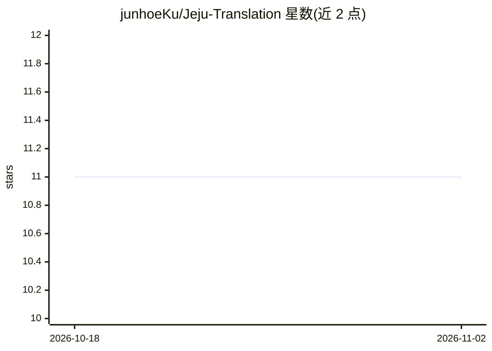

# junhoeKu/Jeju-Translation

⭐ 11 · Jupyter Notebook · 推送 2026-07-08 · [GitHub](https://github.com/junhoeKu/Jeju-Translation) · 组织维护

**济州方言与韩语标准语双向翻译与语音模型项目（学生团队）**

韩国大学生团队（비타민 12/13기，2024年1学期）开发的济州方言与标准语双向翻译模型项目：基于 gogamza/kobart-base-v2 预训练模型微调，通过在句首添加 [제주]/[표준] 方向标记 token 实现双向翻译，数据来自 AI-Hub、Kakao Brain jejueo、济州语词典爬取及书籍语料。最终 BLEU 济州→标准 0.76、标准→济州 0.5。另尝试基于 Whisper 微调的济州口音 STT 与济州口音 TTS（TTS 口音尝试未成功，改用标准语 gtts）。限制：TTS 口音失败，Web/移动端仅列于未来计划。

## 筛选速览

| 维度 | 判定 | 备注 |
|---|---|---|
| AI 角色 | `ai-native` | 本体是模型或模型工具 |
| 许可风险 | `none` | — |
| 部署形态 | `None` |  |
| 模型依赖 | — | README 未给出锁定关系 |
| 硬件要求 | — | 无带数字的原话,不猜 |
| 安装摩擦 | `low` | 无编译、无系统依赖或容器化 |
| 成熟度 | — | 结构信号不足 |

## 能力要点

- KoBART 微调 + [제주]/[표준] 方向 token 实现双向翻译
- Whisper 微调学习济州口音的语音识别
- 多来源济州语料收集（AI-Hub/Kakao Brain/词典爬取/书籍）
- 最终 BLEU：济州→标准 0.76，标准→济州 0.5

## 适用场景

- 济州方言与标准韩语之间的句子互译
- 济州口音语音转文字（STT）
- 了解低资源方言翻译的微调与数据构建方法

## 场景标签

`语音识别` `微调` · 领域:感知与多模态

## 证据(README 行号)

> L24: - **제주 방언과 표준어 양방향 번역 모델 생성**
> L29: - 제주 사투리와 한국어 표준어 사이를 연결하는 양방향 번역 모델을 개발합니다.
> L92:  - 허깅페이스에서 Whisper 모델 받아서 Fine-tuning 진행

## 星数曲线

2026-10-18 11 → 2026-11-02 11（+0）

---
*卡片 v1 · prompt 1.4 · 生成 2026-11-02 · 置信度 high · 依据 README sha `59679916a31a` · [字段定义](../../DATASET.md)*
