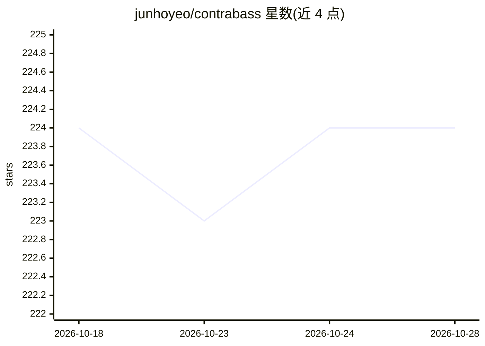

# junhoyeo/contrabass

⭐ 224 · Go · Apache-2.0 · 推送 2026-07-17 · [GitHub](https://github.com/junhoyeo/contrabass) · [官网](https://contrabass.dev) · 个人维护 · 中文 README

**面向 AI 编程 agent 的项目级任务编排器（TUI/Web）**

Go + Charm 栈实现的终端优先编排器，是 OpenAI Symphony 的重实现：从 Linear、GitHub Issues 或内置本地看板拉取 issue，经 WORKFLOW.md（YAML front matter + Liquid 模板）渲染提示词，用 git worktree 创建工作区后调用 Codex app-server、OpenCode、OMX、OMC 等 agent 运行时执行。编排器提供 claim/release、BlockedBy 门控、孤儿认领恢复、分支推进校验、停滞检测与确定性退避重试；支持多 agent 团队（tmux 多进程或 goroutine 进程内两种 worker 模式），并附带 Ziikoo React Web 仪表盘。需 Go 1.25+、Bun、Git，tmux 用于默认团队模式。

## 筛选速览

| 维度 | 判定 | 备注 |
|---|---|---|
| AI 角色 | `ai-ecosystem` | LLM/agent 周边工具 |
| 许可风险 | `permissive` | Apache-2.0 |
| 部署形态 | `desktop` | 安装包/桌面程序 |
| 模型依赖 | — | README 未给出锁定关系 |
| 硬件要求 | — | 无带数字的原话,不猜 |
| 安装摩擦 | `low` | 无编译、无系统依赖或容器化 |
| 成熟度 | — | 结构信号不足 |

## 能力要点

- issue 驱动编排：BlockedBy 门控、认领/释放、分支推进校验、确定性退避重试
- 支持 Codex app-server、OpenCode、oh-my-opencode、OMX、OMC 五种 agent 运行时
- 多 agent 团队模式：tmux 进程隔离与 goroutine 进程内两种 worker 模式
- Charm v2 TUI 与 Ziikoo React Web 仪表盘（SSE 实时流、zh-CN 本地化）

## 适用场景

- 把 Linear/GitHub issue 自动分派给编程 agent 执行并跟踪进度
- 多 agent 团队按 plan→exec→verify 流水线协作处理任务
- 通过 TUI 或本地 Web 仪表盘实时监控 agent 运行状态与 ETA

## 场景标签

`编码 Agent` `多智能体` · 领域:Agent 开发

## 证据(README 行号)

> L5: > **A project-level orchestrator for AI coding agents**
> L19: - Agent runners for **Codex app-server**, **OpenCode**, **oh-my-opencode**, **OMX (oh-my-codex)**, and **OMC (oh-my
> L22: - An orchestrator with claim/release, BlockedBy gating, orphan claim recovery, branch advance verification, stall d

## 星数曲线

2026-10-18 224 → 2026-10-28 224（+0）

---
*卡片 v1 · prompt 1.4 · 生成 2026-10-22 · 置信度 high · 依据 README sha `511302a2a9d8` · [字段定义](../../DATASET.md)*
