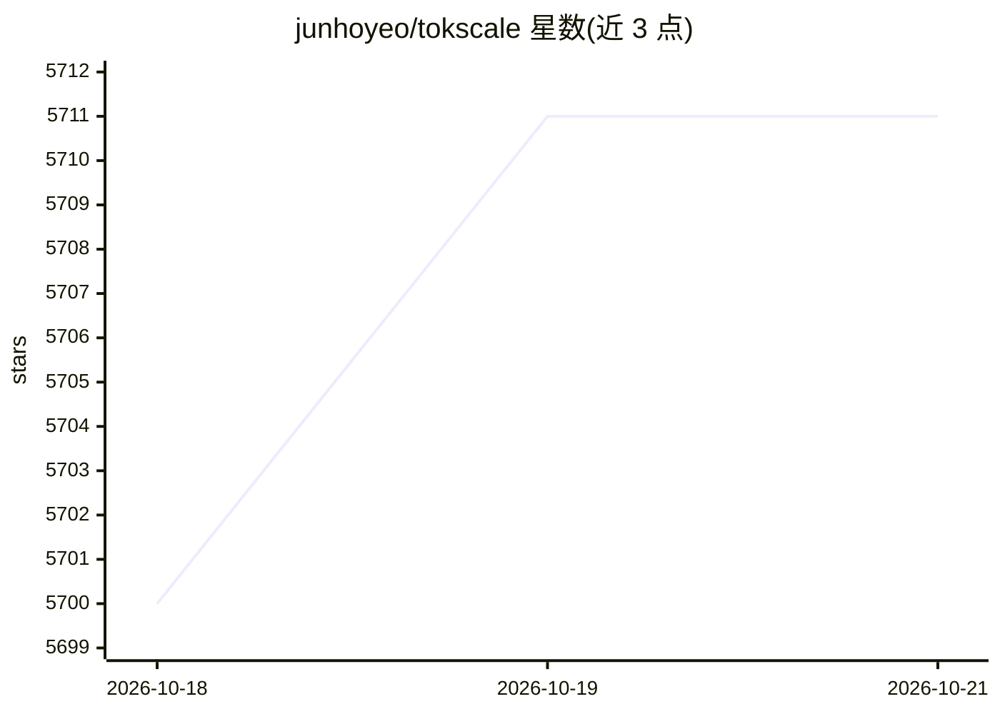

# junhoyeo/tokscale

⭐ 5,711 · Rust · MIT · 推送 2026-10-19 · [GitHub](https://github.com/junhoyeo/tokscale) · [官网](https://tokscale.ai) · 个人维护 · 中文 README

**终端追踪多种 AI 编程 agent 的 token 用量与成本的 CLI**

用 Rust 实现的高性能 CLI 与终端可视化仪表盘（Ratatui TUI，含 Overview/Models/Daily/Sessions 等 10 个交互视图），通过直接读取本地数据文件追踪 60 余种 AI 编程客户端（Claude Code、Codex CLI、Gemini CLI、Cursor、Copilot 等）的 token 消耗，借助 LiteLLM 定价数据计算实时成本，支持分层定价与缓存折扣。提供全球排行榜：用户可通过 bunx 提交用量数据生成公开主页。面向频繁使用多种 AI 编程工具的开发者。

## 筛选速览

| 维度 | 判定 | 备注 |
|---|---|---|
| AI 角色 | `ai-ecosystem` | LLM/agent 周边工具 |
| 许可风险 | `permissive` | MIT |
| 部署形态 | `self-host` | docker 或自建部署 |
| 模型依赖 | — | README 未给出锁定关系 |
| 硬件要求 | — | 无带数字的原话,不猜 |
| 安装摩擦 | `low` | 无编译、无系统依赖或容器化 |
| 成熟度 | — | 结构信号不足 |

## 能力要点

- 读取 60 余种 AI 编程客户端本地数据文件统计用量
- Ratatui TUI 提供 10 个交互视图，支持键盘与鼠标导航
- 基于 LiteLLM 定价数据的实时成本计算（分层定价/缓存折扣）
- 支持提交用量数据至全球排行榜生成公开主页

## 适用场景

- 汇总我在多个 AI 编程工具上的 token 消耗与花费
- 在终端查看按日/小时/项目/会话维度的用量分析
- 把自己的用量提交到排行榜并生成公开主页

## 场景标签

`LLM 可观测性` · 领域:评测与运维

## 证据(README 行号)

> L3: > A high-performance CLI tool and visualization dashboard for tracking token usage and costs across multiple AI codi
> L47: **Tokscale** helps you monitor and analyze your token consumption from:
> L112: Get real-time pricing calculations using 🚅 LiteLLM's pricing data, with support for tiered pricing models and cach
> L126: - **Interactive TUI Mode** - Beautiful terminal UI powered by Ratatui (default mode)

## 星数曲线

2026-10-18 5,700 → 2026-10-21 5,711（+11）

---
*卡片 v1 · prompt 1.4 · 生成 2026-10-20 · 置信度 mid · 依据 README sha `b4b0c1143e97` · [字段定义](../../DATASET.md)*
