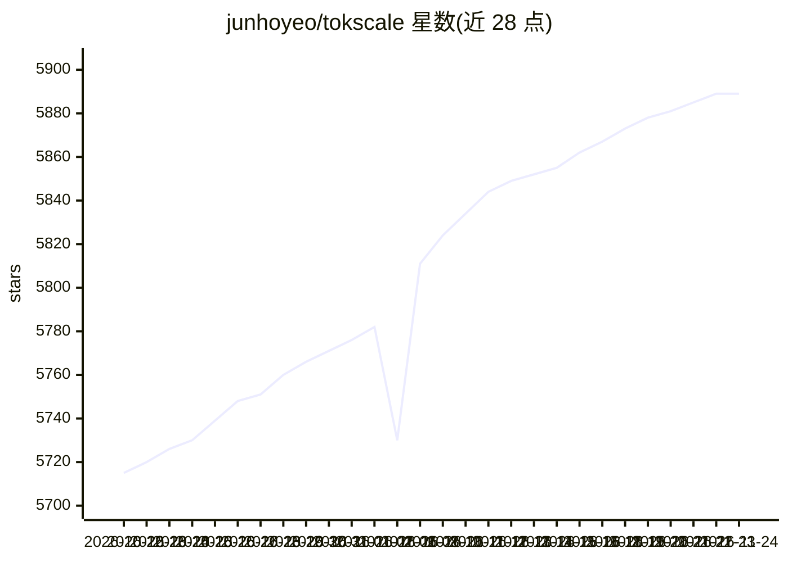

# junhoyeo/tokscale

⭐ 5,889 · Rust · MIT · 推送 2026-11-22 · [GitHub](https://github.com/junhoyeo/tokscale) · [官网](https://tokscale.ai) · 个人维护

**终端 CLI：统计多个 AI 编码 agent 的 token 用量与成本**

Tokscale 是一个 CLI 工具与可视化面板，读取本地多个 AI 编码 agent 留下的会话记录文件（约 60 种客户端，含 SQLite、JSONL、JSON 等格式），汇总 token 用量并按 LiteLLM 定价数据计算成本，提供 TUI 视图（总览、模型、日汇总、会话详情、小时统计）与 3D 贡献图前端；用户可通过 submit 命令将用量数据提交到全球排行榜并生成公开档案。定位为个人开发者的用量追踪工具，本地读取数据，部分客户端需经 sync 子命令缓存。

## 筛选速览

| 维度 | 判定 | 备注 |
|---|---|---|
| AI 角色 | `ai-ecosystem` | LLM/agent 周边工具 |
| 许可风险 | `permissive` | MIT |
| 部署形态 | `self-host` | docker 或自建部署 |
| 模型依赖 | — | README 未给出锁定关系 |
| 硬件要求 | — | 无带数字的原话,不猜 |
| 安装摩擦 | `low` | 无编译、无系统依赖或容器化 |
| 成熟度 | — | 结构信号不足 |

## 能力要点

- 支持读取约 60 种 AI 编码 agent 的本地会话数据文件
- 基于 LiteLLM 定价数据计算成本，支持分层定价与缓存 token 折扣
- TUI 提供总览/模型/日汇总/会话详情/小时统计视图
- bunx submit 提交用量到全球排行榜并生成公开档案

## 适用场景

- 统计自己在多个 AI 编码工具上的 token 消耗与花费
- 查看按模型、按天、按会话粒度的用量明细
- 在排行榜上展示自己的 agent 用量档案

## 场景标签

 · 领域:开发者工具/AI 编码辅助生态

## 证据(README 行号)

> L3: > A high-performance CLI tool and visualization dashboard for tracking token usage and costs across multiple AI codi
> L47: **Tokscale** helps you monitor and analyze your token consumption from:
> L116: Get real-time pricing calculations using 🚅 LiteLLM's pricing data, with support for tiered pricing models and cach

## 星数曲线

2026-10-22 5,715 → 2026-11-24 5,889（+174）

---
*卡片 v1 · prompt 1.4 · 生成 2026-11-22 · 置信度 mid · 依据 README sha `c5b3b6e9e167` · [字段定义](../../DATASET.md)*
