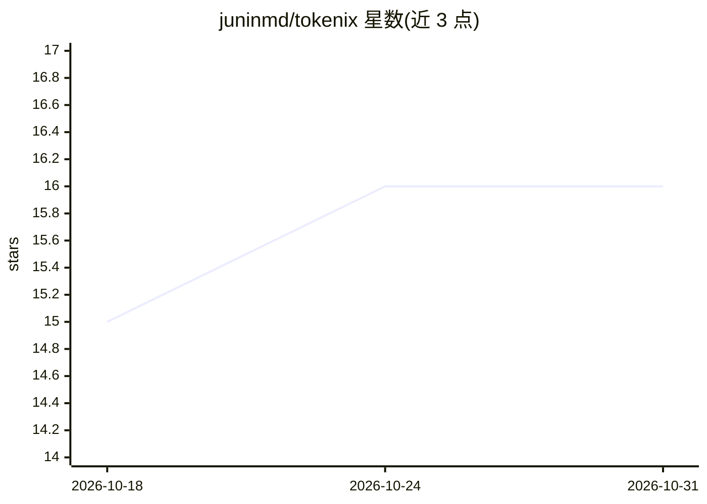

# juninmd/tokenix

⭐ 16 · Rust · MIT · 推送 2026-10-29 · [GitHub](https://github.com/juninmd/tokenix) · 个人维护

**AI 编码代理的本地代码索引与输出过滤器 CLI，降低 token 消耗**

Rust 编写的 CLI 工具，运行在 AI 编码代理与代码仓库之间：在本地用 SQLite 建立按符号分块的索引，基于 Tree-sitter 构建 AST 符号图（PageRank 重要性、caller/callee 追踪、diff 影响分析），代理可按需调用 outline 读取单个函数而非整个文件；同时以 534 个内置确定性过滤器裁剪构建/测试等噪声输出（声称减少 40-90% token），失败输出带凭据脱敏后完整保留可取回。通过原生 hook 接入 Claude Code、Codex、Copilot、Antigravity、OpenCode 及任意 MCP 客户端；安装提供预编译二进制或 cargo，从源码构建需 Rust 工具链（MSRV 1.90）。

## 筛选速览

| 维度 | 判定 | 备注 |
|---|---|---|
| AI 角色 | `ai-ecosystem` | LLM/agent 周边工具 |
| 许可风险 | `permissive` | MIT |
| 部署形态 | `desktop` | 安装包/桌面程序 |
| 模型依赖 | locked-api |  |
| 硬件要求 | — | 无带数字的原话,不猜 |
| 安装摩擦 | `low` | 无编译、无系统依赖或容器化 |
| 成熟度 | — | 结构信号不足 |

## 能力要点

- SQLite 本地索引 + Tree-sitter 符号图（callers/callees/impact/blast）
- 534 个 TOML 规则输出过滤器，保留真实退出码，fail-open 契约
- 凭据在途脱敏与 secrets 扫描，仓库内过滤器需 SHA-256 信任门
- 原生 hook 接入 Claude Code/Codex/Copilot/Antigravity/OpenCode/MCP

## 适用场景

- 让编码代理只读所需函数而非整个文件以省 token
- 裁剪冗长的测试/构建输出但保留错误信息
- 变更前分析 diff 的调用图影响范围
- 扫描仓库与命令输出中的凭据泄漏

## 场景标签

 · 领域:开发者工具/AI 代理基础设施

## 证据(README 行号)

> L27: > ⚡ **tokenix** is a high-performance Rust CLI that sits directly between your AI coding agent and your repository.
> L44: |In-flight credential masking on hooks and failure tees. Repo-controlled filters are isolated behind SHA-256 trust 
> L75: tokenix install-hook --tool claude-code   # or codex · copilot · antigravity · opencode · all

## 星数曲线

2026-10-18 15 → 2026-10-31 16（+1）

---
*卡片 v1 · prompt 1.4 · 生成 2026-10-30 · 置信度 high · 依据 README sha `a6f44bac19c7` · [字段定义](../../DATASET.md)*
