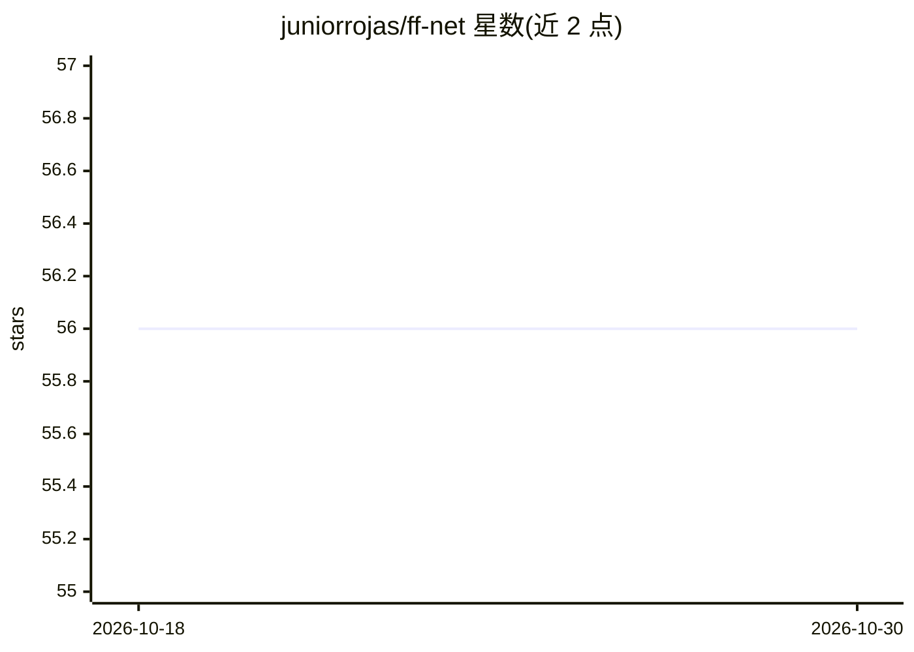

# juniorrojas/ff-net

⭐ 56 · JavaScript · MIT · 推送 2026-10-15 · [GitHub](https://github.com/juniorrojas/ff-net) · [官网](http://juniorrojas.com/ff-net) · 个人维护

**实时展示前馈神经网络学习过程的可视化演示**

提供前馈神经网络实时学习的交互式网页演示。README 极简，仅含项目说明、演示标题与指向 GitHub Pages 的交互式 demo 链接，未给出安装步骤、依赖说明或 API 文档。从主题标签可知其涉及机器学习、神经网络与可视化。用户通过浏览器访问在线演示即可观察神经网络训练的实时过程。

## 筛选速览

| 维度 | 判定 | 备注 |
|---|---|---|
| AI 角色 | `ai-native` | 本体是模型或模型工具 |
| 许可风险 | `permissive` | MIT |
| 部署形态 | `None` |  |
| 模型依赖 | — | README 未给出锁定关系 |
| 硬件要求 | — | 无带数字的原话,不猜 |
| 安装摩擦 | `low` | 无编译、无系统依赖或容器化 |
| 成熟度 | — | 结构信号不足 |

## 能力要点

- 前馈神经网络实时学习过程演示
- 提供在线交互式 demo（GitHub Pages）

## 适用场景

- 在浏览器中观察神经网络训练的实时过程
- 用于理解前馈网络的学习行为

## 场景标签

`教程课程` · 领域:学习与行业

## 证据(README 行号)

> L5: Feedforward neural network learning in real time.
> L9:  <a href="http://juniorrojas.github.io/ff-net">

## 星数曲线

2026-10-18 56 → 2026-10-30 56（+0）

---
*卡片 v1 · prompt 1.4 · 生成 2026-10-24 · 置信度 low · 依据 README sha `2620dd76b348` · [字段定义](../../DATASET.md)*
