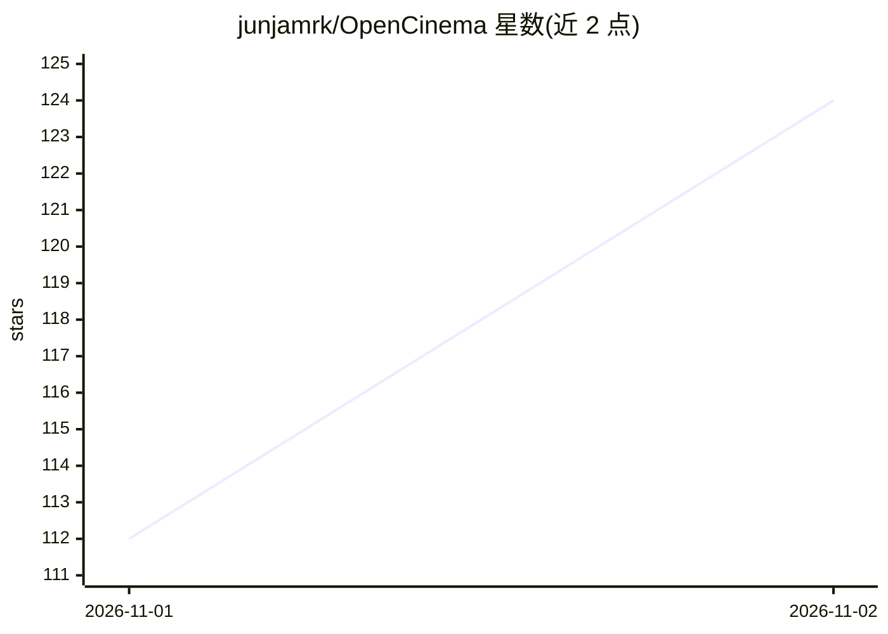

# junjamrk/OpenCinema

⭐ 124 · TypeScript · MIT · 推送 2026-11-01 · [GitHub](https://github.com/junjamrk/OpenCinema) · [官网](https://opencinema.site/) · 个人维护 · 中文 README

**本地优先的 AI 视频工作室：画布+3D预演+生成剪辑一体**

面向影视/短剧创作者的本地优先视频工作室：将剧本、参考素材、Blockout 3D 预演、图像/视频/音频生成与编辑计划组织为同一画布上的节点图。用户可直接配置模型服务商生成，也可接入 Claude Code、Codex 等 MCP 客户端让 agent 通过公开 MCP 工具读写画布，人与 agent 共享同一命令路径与撤销历史。生成后端可替换（云模型、本地服务、ComfyUI 工作流），Go 服务仅监听环回地址，数据留在本地。当前 0.4.0 开发中未发布：源码构建仅支持 macOS/Linux，Windows 不支持，工作台界面暂仅中文。

## 筛选速览

| 维度 | 判定 | 备注 |
|---|---|---|
| AI 角色 | `ai-native` | 本体是模型或模型工具 |
| 许可风险 | `permissive` | MIT |
| 部署形态 | `library` | 以包/库形式分发 |
| 模型依赖 | — | README 未给出锁定关系 |
| 硬件要求 | — | 无带数字的原话,不猜 |
| 安装摩擦 | `medium` | 含编译或系统依赖之一 |
| 成熟度 | `idea` | |

## 能力要点

- 单画布节点图覆盖脚本、预演、生成、审看与剪辑计划
- Agent 经 MCP 工具读写画布，与人共享命令路径与撤销历史
- Blockout 3D 预演导出 RGB/Depth/Normal 作为生成参考，可只替换单个镜头
- 支持 12 类生成后端（fal/Replicate/ComfyUI/自定义等），任务重启后恢复观察原任务

## 适用场景

- 短剧/短片从预演、生成到剪辑的完整制作流程
- 用 Claude Code 或 Codex 等 agent 在画布上做批量生成与规划
- 只重做失败镜头而保留其余片段的迭代剪辑

## 场景标签

`图像生成` `视频生成` · 领域:内容生成

## 证据(README 行号)

> L5:  A local-first AI video studio. One canvas connects storyboards, assets, 3D previs, generation and editing,
> L37: - **Your agent works on the same canvas.** Describe what you want in Codex, Claude Code or any MCP client. The agen
> L217: |Provider|Image|Video|Audio|

## 星数曲线

2026-11-01 112 → 2026-11-02 124（+12）

---
*卡片 v1 · prompt 1.4 · 生成 2026-10-31 · 置信度 mid · 依据 README sha `986adfde8ea5` · [字段定义](../../DATASET.md)*
