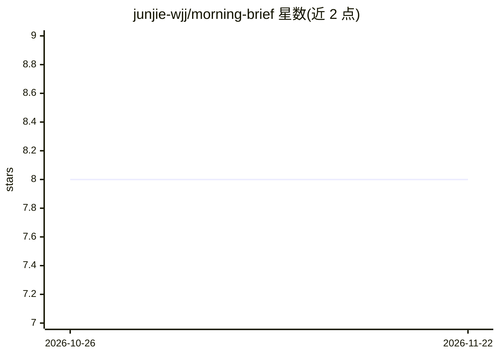

# junjie-wjj/morning-brief

⭐ 8 · JavaScript · MIT · 推送 2026-10-25 · [GitHub](https://github.com/junjie-wjj/morning-brief) · [官网](https://morning-brief-junjie.netlify.app) · 个人维护 · 中文 README

**个人 AI 资讯早餐生成器：每天 7 点自动抓取并加工中文摘要**

面向个人读者的每日资讯聚合应用：由 GitHub Actions 每天 7 点定时运行管线，从官方博客、HN、GitHub、HF、社区、中文媒体 6 类信息源抓取内容，经 LLM 生成中文标题、摘要与兴趣分，经三道入库闸门（屏蔽词、低分不入库、分类分数门槛）与去重后写入 Turso 数据库，由 Next.js 网站展示。支持点赞/点踩反馈影响排序的偏好学习、全文搜索、PWA、每周加密备份与 109 个单元测试。自部署依赖智谱 API key、Turso、Netlify 等免费额度。

## 筛选速览

| 维度 | 判定 | 备注 |
|---|---|---|
| AI 角色 | `ai-native` | 本体是模型或模型工具 |
| 许可风险 | `permissive` | MIT |
| 部署形态 | `library` | 以包/库形式分发 |
| 模型依赖 | — | README 未给出锁定关系 |
| 硬件要求 | — | 无带数字的原话,不猜 |
| 安装摩擦 | `low` | 无编译、无系统依赖或容器化 |
| 成熟度 | — | 结构信号不足 |

## 能力要点

- GitHub Actions 每日定时管线：抓取 → LLM 加工 → 闸门 → 去重 → 出刊
- 点赞/点踩反馈实时影响排序的偏好画像机制
- 三道入库闸门拦截低质内容，节省 LLM 额度
- 全链路运行于免费额度（GitHub Actions/智谱 GLM-Flash/Turso/Netlify）

## 适用场景

- 每天用 3 分钟读一份个人定制的 AI 资讯摘要
- 通过点赞反馈让资讯排序越来越贴合个人口味
- 自部署一套全免费额度的个人资讯聚合站

## 场景标签

`网页抓取` `工作流自动化` · 领域:效率与自动化

## 证据(README 行号)

> L3: > **一份每天早上 7 点自动生成的个人 AI 资讯早餐** —— 从 6 类信息源抓取、LLM 加工成中文摘要并打分、按你的口味个性化排序，全链路零成本运行于免费额度之上。
> L28: **内容管线**：6 类固定信息源（官方博客/HN/GitHub/HF/社区/中文媒体）+ 偏好搜索 + 4 个可勾选的固定关注方向（免费额度/榜单/MCP·插件·技能/价格）+ OpenRouter 免费模型上下架监控 · LL

## 星数曲线

2026-10-26 8 → 2026-11-22 8（+0）

---
*卡片 v1 · prompt 1.4 · 生成 2026-11-20 · 置信度 high · 依据 README sha `f8b4e39d12cf` · [字段定义](../../DATASET.md)*
