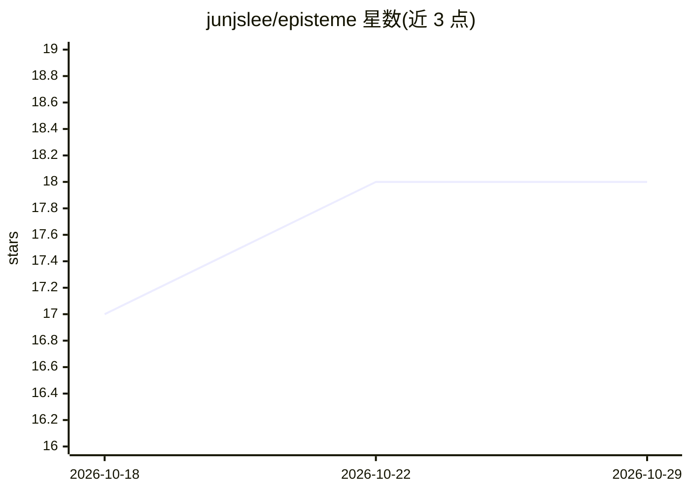

# junjslee/episteme

⭐ 18 · Python · AGPL-3.0 · 推送 2026-07-21 · [GitHub](https://github.com/junjslee/episteme) · [官网](https://www.epistemekernel.com) · 个人维护 · 中文 README

**AI agent 决策前置审计框架：行动前强制写出可证伪推理**

面向使用 AI 编码代理（Claude Code 等）的开发者的认知治理框架。核心机制：在高影响操作（push/deploy 等）执行前，hook 拦截并要求 agent 在磁盘上写出推理面——核心问题、已知/未知、假设与可证伪的反证条件，敷衍填写不过闸；关键决策可触发独立上下文的对抗性复核。验证过的经验固化为防篡改协议（hash 链），在匹配上下文再次出现时复现；文档带生命周期标记并在 CI 中做漂移检查。内核为纯 markdown，适配层可换（Claude Code、Hermes、OMO/OMX）。提供 Claude Code 插件与 pip 可编辑安装两种途径；版本 1.10.0-rc.1，附自述失败案例与边界说明。

## 筛选速览

| 维度 | 判定 | 备注 |
|---|---|---|
| AI 角色 | `ai-ecosystem` | LLM/agent 周边工具 |
| 许可风险 | `dual` | AGPL-3.0 |
| 部署形态 | `library` | 以包/库形式分发 |
| 模型依赖 | locked-api |  |
| 硬件要求 | — | 无带数字的原话,不猜 |
| 安装摩擦 | `low` | 无编译、无系统依赖或容器化 |
| 成熟度 | `idea` | |

## 能力要点

- 高影响操作执行前的确定性闸门：推理面不达标则不执行
- 推理面协议：核心问题/已知/未知/假设/预承诺反证条件
- 验证经验固化为防篡改协议并按上下文复现
- 内核为纯 markdown，适配层（Claude Code/Hermes/OMO/OMX）可换

## 适用场景

- 在 agent 执行 push/deploy 等不可逆操作前审查其推理
- 把验证过的决策经验沉淀为跨工具复用的协议
- 对项目文档做生命周期治理与 CI 漂移检查

## 场景标签

 · 领域:AI agent 治理/开发者工具

## 证据(README 行号)

> L18: > It plugs into the tools you already use (Claude Code today; a vendor-neutral adapter layer for others). Lessons f
> L50: - **A gate at the point of no return.** High-impact operations get intercepted before they run, and the agent's rea
> L123: Four ideas, in the colors above. **Doxa** (red) is fluent-but-unvalidated output — the failure state this whole th

## 星数曲线

2026-10-18 17 → 2026-10-29 18（+1）

---
*卡片 v1 · prompt 1.4 · 生成 2026-10-29 · 置信度 high · 依据 README sha `a7efa5c3f15f` · [字段定义](../../DATASET.md)*
