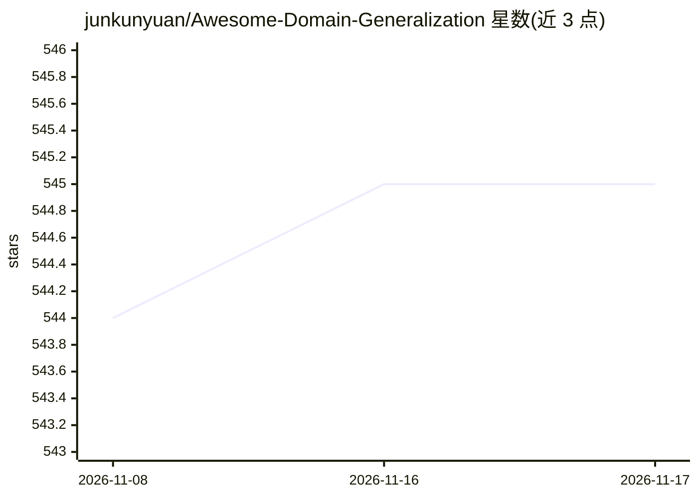

# junkunyuan/Awesome-Domain-Generalization

⭐ 545 · 推送 2026-11-07 · [GitHub](https://github.com/junkunyuan/Awesome-Domain-Generalization) · 个人维护

**领域泛化（Domain Generalization）论文与代码策展清单**

收录领域泛化（Domain Generalization）研究的 awesome list：按综述、理论分析、数据集、领域对齐方法、数据增强方法等类别组织论文条目，标注会议/期刊出处、官方或非官方实现代码（非官方标记 *）及对应数据集（PACS、DomainNet、OfficeHome、ImageNet-C 等），按年份排列并接受社区贡献。面向该方向的科研人员与学生，用于查找论文、基准数据集与实现代码。

## 筛选速览

| 维度 | 判定 | 备注 |
|---|---|---|
| AI 角色 | `ai-knowledge` | 知识聚合/清单类 |
| 许可风险 | `none` | — |
| 部署形态 | `None` |  |
| 模型依赖 | — | README 未给出锁定关系 |
| 硬件要求 | — | 无带数字的原话,不猜 |
| 安装摩擦 | `low` | 无编译、无系统依赖或容器化 |
| 成熟度 | — | 结构信号不足 |

## 能力要点

- 按综述/理论/数据集/方法类别组织论文条目
- 每条标注发表出处与实现代码（非官方标记 *）
- 收录 20+ 个常用基准数据集（PACS、DomainNet、OfficeHome 等）
- 接受社区贡献与联系反馈

## 适用场景

- 查找领域泛化方向的论文与官方代码实现
- 选择该方向常用的基准数据集开展实验
- 按方法类别（领域对齐/数据增强等）浏览研究脉络

## 场景标签

`精选清单` `科研工具` · 领域:学习与行业

## 证据(README 行号)

> L4: This repository is a collection of awesome things about **domain generalization**, including papers, code, etc.
> L11: > We list papers, implementation code (the unofficial code is marked with *), etc, in the order of year and from jo

## 星数曲线

2026-11-08 544 → 2026-11-17 545（+1）

---
*卡片 v1 · prompt 1.4 · 生成 2026-11-17 · 置信度 high · 依据 README sha `3d796a92ee48` · [字段定义](../../DATASET.md)*
