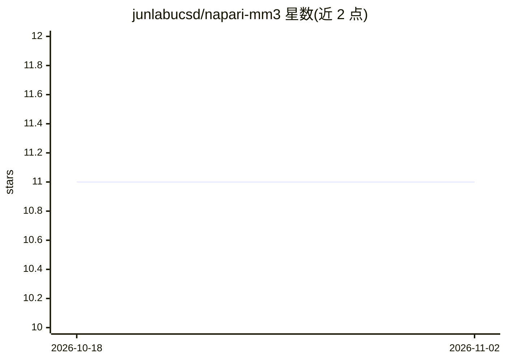

# junlabucsd/napari-mm3

⭐ 11 · Jupyter Notebook · BSD-3-Clause · 推送 2026-06-06 · [GitHub](https://github.com/junlabucsd/napari-mm3) · 组织维护

**母机显微图像分析的 napari 插件，面向单细胞高通量成像**

Jun Lab 开发的 napari 插件，用于母机（mother machine）显微图像分析：将 nd2 等格式经 bioformats 转为 TIFF，定位培养通道并拆分时序图像，支持 Otsu 阈值与 U-Net 两种细胞分割（U-Net 需另下载模型或自行训练），并提供细胞谱系追踪、荧光定量、foci 追踪与数据提取绘图。安装方式为 git clone 后 conda 建环境并 pip install -e . --no-dependencies。对应 eLife 论文的配套工具。

## 筛选速览

| 维度 | 判定 | 备注 |
|---|---|---|
| AI 角色 | `ai-native` | 本体是模型或模型工具 |
| 许可风险 | `permissive` | BSD-3-Clause |
| 部署形态 | `library` | 以包/库形式分发 |
| 模型依赖 | — | README 未给出锁定关系 |
| 硬件要求 | — | 无带数字的原话,不猜 |
| 安装摩擦 | `low` | 无编译、无系统依赖或容器化 |
| 成熟度 | — | 结构信号不足 |

## 能力要点

- TIFFConverter 经 bioformats 读取 nd2 等显微数据
- Otsu 与 U-Net 两种细胞分割路径（含 U-Net 训练 widget）
- 细胞谱系追踪与荧光/foci 追踪分析

## 适用场景

- 母机实验的单细胞时序图像分割与追踪
- 训练 U-Net 模型做细菌细胞分割
- 提取谱系数据并计算荧光信息

## 场景标签

`图像视频处理` `目标检测` · 领域:感知与多模态

## 证据(README 行号)

> L9: A plugin for mother machine image analysis by the Jun Lab.
> L67: * Train U-Net -- Train a U-Net model for cell segmentation.
> L69: * SegmentUnet -- Run U-Net segmentation.

## 星数曲线

2026-10-18 11 → 2026-11-02 11（+0）

---
*卡片 v1 · prompt 1.4 · 生成 2026-11-02 · 置信度 high · 依据 README sha `7316f8914fcb` · [字段定义](../../DATASET.md)*
