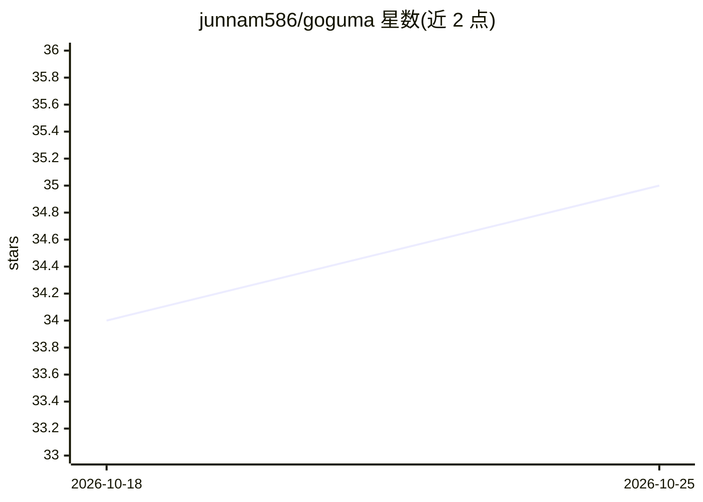

# junnam586/goguma

⭐ 35 · Go · MIT · 推送 2026-08-29 · [GitHub](https://github.com/junnam586/goguma) · [官网](https://getgoguma.com) · 个人维护

**macOS/Linux 保醒工具：为定时任务与编码 agent 保持机器唤醒**

菜单栏应用加 CLI 形式的电源管理工具：自动发现机器上已有的 cron/launchd/应用内定时任务，在任务触发前唤醒机器、任务结束后允许休眠，并报告哪些任务曾被静默错过。对无固定排程的长任务（长构建、大同步、编码 agent），可用 goguma run 包裹命令，或在编辑器 agent 工作期间保持唤醒（支持合盖运行），通过 hooks 为 Claude Code、Codex、Cursor、Gemini CLI 配置报告机制。含 CPU 过热与低电量提前释放等安全限制。需 macOS 14+ 或 Linux systemd。

## 筛选速览

| 维度 | 判定 | 备注 |
|---|---|---|
| AI 角色 | `ai-enhanced` | 去掉 AI 部分产品仍成立 |
| 许可风险 | `permissive` | MIT |
| 部署形态 | `library` | 以包/库形式分发 |
| 模型依赖 | — | README 未给出锁定关系 |
| 硬件要求 | — | 无带数字的原话,不猜 |
| 安装摩擦 | `medium` | 含编译或系统依赖之一 |
| 成熟度 | — | 结构信号不足 |

## 能力要点

- 自动发现 cron/launchd/应用内调度任务并按需唤醒机器
- goguma run 包裹任意命令，命令运行期间阻止休眠（含合盖）
- 为 Claude Code/Codex/Cursor/Gemini CLI 配置 agent 工作期间的保醒 hooks
- 过热（默认 80°C）或低电量（默认 10%）时提前释放保醒

## 适用场景

- 定时备份/同步任务不再因机器休眠被静默错过
- 合盖状态下让编码 agent 或长构建继续运行
- 通过菜单栏查看并控制当前保醒状态与即将到来的唤醒

## 场景标签

 · 领域:系统工具/电源管理

## 证据(README 行号)

> L30: no schedule at all still takes as long as it takes: a coding agent chewing
> L68: - goguma keeps a coding agent running with the lid shut, set up for you and
> L198: Claude Code, Codex, Cursor and Gemini CLI are covered. Each session holds

## 星数曲线

2026-10-18 34 → 2026-10-25 35（+1）

---
*卡片 v1 · prompt 1.4 · 生成 2026-10-25 · 置信度 high · 依据 README sha `7db580de13b0` · [字段定义](../../DATASET.md)*
