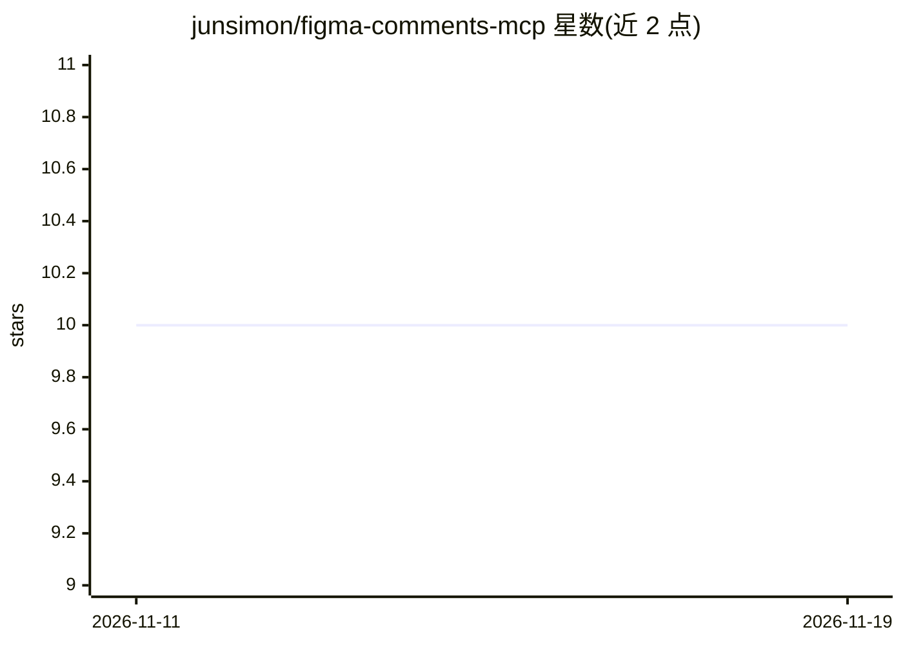

# junsimon/figma-comments-mcp

⭐ 10 · TypeScript · MIT · 推送 2026-06-23 · [GitHub](https://github.com/junsimon/figma-comments-mcp) · 个人维护

**让 Claude 读取并操作 Figma/FigJam 画布评论的本地 MCP 服务器**

一个 TypeScript 编写的本地 MCP 服务器，封装 Figma REST 评论 API，读取设计文件与 FigJam 白板上的钉选评论，并将每条评论解析到其对应的图层/便签节点（名称+路径+node id），官方 Figma MCP 未提供评论层，本服务器与其并列组合使用。提供 4 个读取工具与 3 个默认 dry_run 的写入工具（回复/表情/发评论），写入需显式开启环境变量；REST API 无法标记评论已解决为其限制。需 Node 20+ 与 Figma Personal Access Token。

## 筛选速览

| 维度 | 判定 | 备注 |
|---|---|---|
| AI 角色 | `ai-ecosystem` | LLM/agent 周边工具 |
| 许可风险 | `permissive` | MIT |
| 部署形态 | `library` | 以包/库形式分发 |
| 模型依赖 | — | README 未给出锁定关系 |
| 硬件要求 | — | 无带数字的原话,不猜 |
| 安装摩擦 | `low` | 无编译、无系统依赖或容器化 |
| 成熟度 | — | 结构信号不足 |

## 能力要点

- 评论→节点映射：直接偏移查 node_id，坐标命中用包围盒推断并标注 [inferred]
- 4 个读取工具：摘要计数、分组线程列表、单线程详情、渲染目标节点图像
- 写入工具默认 dry_run 预览，且需 FIGMA_ENABLE_WRITES=true 才注册
- 文件树一次性获取并内存缓存（TTL 默认 60s），支持 4 种 URL 形式与调试 CLI

## 适用场景

- 让 AI 助手按画布评论逐条执行设计修改（如把指定按钮改色）
- 设计评审/QA 后用 AI 汇总开放线程并批量回复处理状态
- 工作坊/头脑风暴后解析便签上的评论并归组到对应节点

## 场景标签

 · 领域:开发工具/设计协作

## 证据(README 行号)

> L8: A local MCP server that lets Claude (or any MCP client) **read, understand, and act on comments in Figma _and_ FigJa
> L16: It composes alongside the official Figma MCP — that one reads design structure and writes design changes; this one 
> L125: The server speaks MCP over **stdio**. For Claude Code, either run:

## 星数曲线

2026-11-11 10 → 2026-11-19 10（+0）

---
*卡片 v1 · prompt 1.4 · 生成 2026-11-19 · 置信度 high · 依据 README sha `4c33a90fec30` · [字段定义](../../DATASET.md)*
