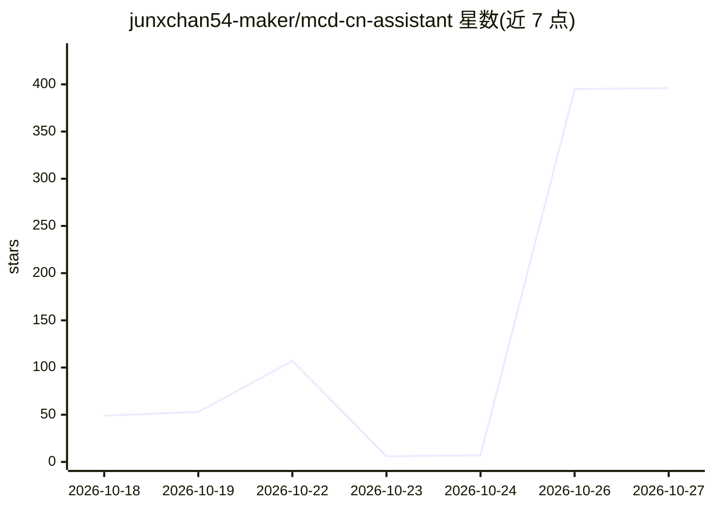

# junxchan54-maker/mcd-cn-assistant

⭐ 396 · NOASSERTION · 推送 2026-10-17 · [GitHub](https://github.com/junxchan54-maker/mcd-cn-assistant) · 个人维护 · 中文 README

**麦当劳中国 MCP 助手技能：把 35 个官方工具编排成点餐/活动/拼单分账流程**

建立在麦当劳中国官方 MCP 服务（mcp.mcd.cn，35 个原子工具）之上的 Agent 技能包，以 SKILL.md + 配置 + 参考文档形式分发给任意支持 MCP 的客户端（WorkBuddy、Claude Code、Cursor 等），需自备 MCP Token。核心机制：把原子工具编排成活动推送、联名关注、最优惠点餐、多人群点分账等业务流；金额一律经 calculate-price 实算；下单等写操作必须列明细并获用户显式同意。仅面向中国大陆，MCP 远程托管、无本地进程。

## 筛选速览

| 维度 | 判定 | 备注 |
|---|---|---|
| AI 角色 | `ai-native` | 本体是模型或模型工具 |
| 许可风险 | `none` | NOASSERTION |
| 部署形态 | `None` |  |
| 模型依赖 | — | README 未给出锁定关系 |
| 硬件要求 | — | 无带数字的原话,不猜 |
| 安装摩擦 | `low` | 无编译、无系统依赖或容器化 |
| 成熟度 | — | 结构信号不足 |

## 能力要点

- 四条主业务流 + 小红书场景六项能力编排 35 个官方 MCP 工具
- 所有金额经 calculate-price 实算，写操作强制二次确认
- 群点代录、满减凑单、券归属与公共费用分摊，输出每人应付账单
- 不绑定特定 Agent 框架，兼容任何支持 MCP 的客户端

## 适用场景

- 一句话查询并订阅麦当劳当月活动/联名推送
- 枚举券组合实算比价，拿到最优惠点餐方案
- 办公室多人拼单代录与账单分摊
- 复刻小红书隐藏吃法、凑穷鬼套餐、按营养约束配餐

## 场景标签

 · 领域:生活服务/Agent 技能

## 证据(README 行号)

> L17: `mcd-cn-assistant` 是一个**面向 AI Agent 的技能包（Skill）**，建立在**麦当劳中国官方 MCP 服务**（<https://mcp.mcd.cn>）之上。
> L21: 本项目做的事情是：**把这堆原子工具编排成四条用户真正会用的业务流**，并把安全边界写死。
> L98: - 任意支持 MCP 的 AI 客户端（WorkBuddy / Claude Code / Cursor / Cline / Cherry Studio / Trae / Kiro / VSCode Copilot 等）；

## 星数曲线

2026-10-18 49 → 2026-10-27 396（+347）

---
*卡片 v1 · prompt 1.4 · 生成 2026-10-25 · 置信度 high · 依据 README sha `9e818f49c1bf` · [字段定义](../../DATASET.md)*
