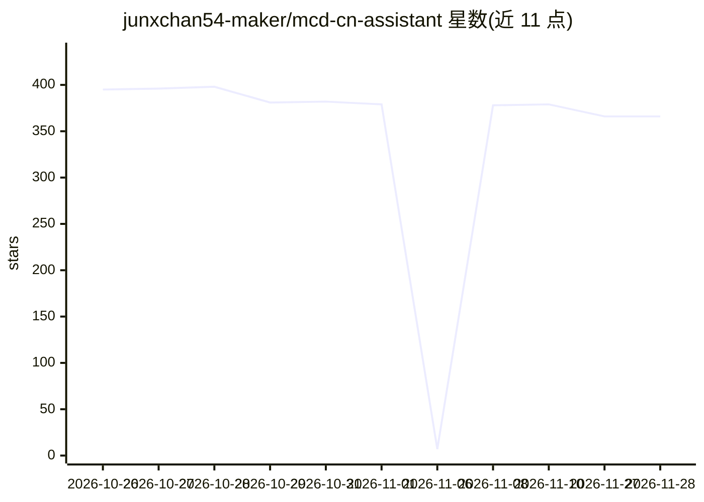

# junxchan54-maker/mcd-cn-assistant

⭐ 366 · NOASSERTION · 推送 2026-10-27 · [GitHub](https://github.com/junxchan54-maker/mcd-cn-assistant) · 个人维护 · 中文 README

**给麦当劳中国 MCP 用户的点餐 Agent 技能：活动/优惠/拼单算账**

建立在麦当劳中国官方 MCP 服务（mcp.mcd.cn，35 个原子工具）之上的 Agent 技能包，由 SKILL.md、config/ 与 references/ 组成。将查门店、查券、calculate-price 算价、create-order 下单等原子工具编排为四条业务流（活动推送、联名关注、最优惠点餐、群点聚合账单）与社媒场景六项。安全边界写死：所有写操作须二次确认，金额以 calculate-price 返回为准。需自备 MCP Token，仅覆盖中国大陆。

## 筛选速览

| 维度 | 判定 | 备注 |
|---|---|---|
| AI 角色 | `ai-native` | 本体是模型或模型工具 |
| 许可风险 | `none` | NOASSERTION |
| 部署形态 | `None` |  |
| 模型依赖 | — | README 未给出锁定关系 |
| 硬件要求 | — | 无带数字的原话,不猜 |
| 安装摩擦 | `low` | 无编译、无系统依赖或容器化 |
| 成熟度 | — | 结构信号不足 |

## 能力要点

- 将 35 个官方 MCP 原子工具编排为 4 条业务流与 6 项社媒场景
- 最优惠方案逐个调用 calculate-price 实算比价，不靠模型心算
- 写操作（下单/领券/取消）必须列明细并获用户显式同意
- 群点聚合输出每人应付账单，公共费用按消费比例分摊

## 适用场景

- 一句话拉取当月麦当劳活动日历与联名款推送
- 在券与满减约束下让 Agent 算出应付最低的点法
- 办公室多人拼单时代录餐品、凑满减并生成每人应付账单
- 按热量/蛋白/控糖约束组合营养搭配并算价下单

## 场景标签

 · 领域:消费/生活服务 Agent 应用

## 证据(README 行号)

> L17: `mcd-cn-assistant` 是一个**面向 AI Agent 的技能包（Skill）**，建立在**麦当劳中国官方 MCP 服务**（<https://mcp.mcd.cn>）之上。
> L21: 本项目做的事情是：**把这堆原子工具编排成四条用户真正会用的业务流**，并把安全边界写死。
> L306: 技能本身不绑定任何特定的 Agent 框架。`SKILL.md` 与 `references/mcd-tools.md` 全程使用**官方工具名**（`query-meals`、`calculate-price` 等）描述流程，

## 星数曲线

2026-10-26 395 → 2026-11-28 366（-29）

---
*卡片 v1 · prompt 1.4 · 生成 2026-11-25 · 置信度 high · 依据 README sha `5393f40eb458` · [字段定义](../../DATASET.md)*
