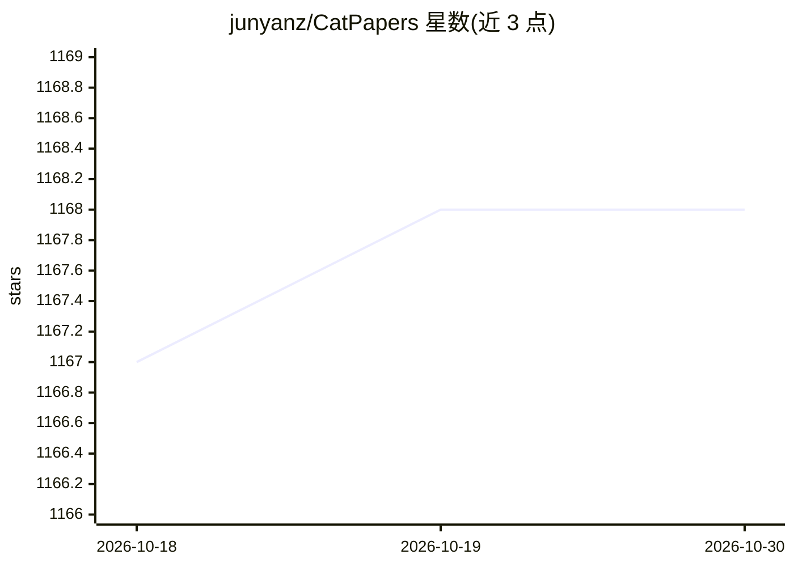

# junyanz/CatPapers

⭐ 1,168 · Python · 推送 2026-01-24 · [GitHub](https://github.com/junyanz/CatPapers) · 个人维护

**收录猫相关实验结果的计算机视觉/图形学/机器学习论文清单**

由 Jun-Yan Zhu 维护的学术论文合集，收录计算机图形学、计算机视觉与机器学习领域中产出与猫相关实验结果的论文，时间跨度约 2010 至 2025 年，涵盖 SIGGRAPH、CVPR、ICCV、ECCV、NeurIPS 等会议与期刊。条目含标题、作者、发表 venue 与论文/项目链接，另提供网页版与 CSV 文件，增删条目通过邮件联系维护者。本仓库为纯文献列表，无代码或安装内容。

## 筛选速览

| 维度 | 判定 | 备注 |
|---|---|---|
| AI 角色 | `ai-knowledge` | 知识聚合/清单类 |
| 许可风险 | `none` | — |
| 部署形态 | `None` |  |
| 模型依赖 | — | README 未给出锁定关系 |
| 硬件要求 | — | 无带数字的原话,不猜 |
| 安装摩擦 | `low` | 无编译、无系统依赖或容器化 |
| 成熟度 | — | 结构信号不足 |

## 能力要点

- 收录计算机图形学、视觉与机器学习三大领域猫相关论文
- 条目提供作者、发表 venue 与论文/项目链接
- 另提供网页版与 CSV 文件两种浏览形式

## 适用场景

- 查找以猫为实验对象的视觉与图形学论文
- 了解猫相关研究在各会议的分布
- 以 CSV 形式批量获取论文列表

## 场景标签

`精选清单` · 领域:学习与行业

## 证据(README 行号)

> L3: As reported by Cisco, 90% of net traffic will be visual, and indeed, most of the visual data are cat photos and vide
> L5: **Cat Paper Collection** is an academic paper collection that includes computer graphics, computer vision, and machi

## 星数曲线

2026-10-18 1,167 → 2026-10-30 1,168（+1）

---
*卡片 v1 · prompt 1.4 · 生成 2026-10-21 · 置信度 high · 依据 README sha `0b40308b3aad` · [字段定义](../../DATASET.md)*
