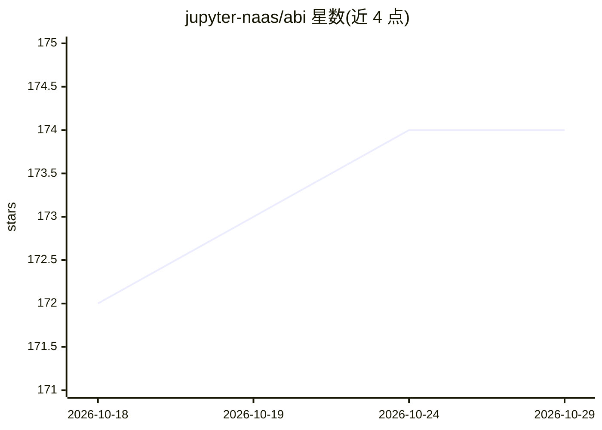

# jupyter-naas/abi

⭐ 174 · Python · MIT · 推送 2026-10-28 · [GitHub](https://github.com/jupyter-naas/abi) · [官网](https://naas.ai) · 组织维护

**把 LLM 接入组织本体知识图谱的开源 AI 操作系统**

ABI（Agentic Brain Infrastructure）以模块化方式组织 agent、集成连接器、OWL/Turtle 本体、知识图谱管道与工作流，让 LLM 基于组织自有本体与上下文源（知识图谱、向量库、文件系统）进行推理。基础设施各层均为可换适配器（三元组库、向量库、关系库、对象存储、消息总线等，社区版以 Docker 容器提供），基于 BFO 顶层本体并提及对 ISO/IEC 42001 与欧盟 AI Act 合规的支持。提供 Web UI、REST API、CLI 三种界面，自称 Palantir 的开放替代。由 NaasAI、OpenTeams、布法罗大学与 NCOR 协作研发。

## 筛选速览

| 维度 | 判定 | 备注 |
|---|---|---|
| AI 角色 | `ai-ecosystem` | LLM/agent 周边工具 |
| 许可风险 | `permissive` | MIT |
| 部署形态 | `self-host` | docker 或自建部署 |
| 模型依赖 | — | README 未给出锁定关系 |
| 硬件要求 | — | 无带数字的原话,不猜 |
| 安装摩擦 | `low` | 无编译、无系统依赖或容器化 |
| 成熟度 | — | 结构信号不足 |

## 能力要点

- 模块化架构：agent/集成/本体/管道/工作流打包为模块，config.yaml 单行启用
- 全栈可换适配器：三元组库、向量库、关系库、存储、消息总线各层均可替换
- 知识图谱基于 ISO/IEC 21838-2 BFO 顶层本体，数据模型内建可追溯性
- 提供 Web UI、REST API（每个 agent 一个端点）与终端 CLI

## 适用场景

- 在自有数据与本体之上构建组织内的 agent 系统
- 通过 GitHub/Salesforce/LinkedIn/Notion 等集成把外部数据接入知识图谱
- 自托管替代商业 AI 平台并保留对数据与逻辑的所有权

## 场景标签

`知识图谱` `Agent 框架` · 领域:Agent 开发

## 证据(README 行号)

> L7: ABI (Agentic Brain Infrastructure) is the open-source AI Operating System that grounds LLMs in your organization's o
> L81: - **Agents**: LLM-powered agents that reason over the knowledge graph and dispatch to the right domain capability
> L89: Each infrastructure concern is abstracted as a port with a swappable adapter. Change the adapter in `config.yaml`, 

## 星数曲线

2026-10-18 172 → 2026-10-29 174（+2）

---
*卡片 v1 · prompt 1.4 · 生成 2026-10-22 · 置信度 mid · 依据 README sha `1a4dc59b74d8` · [字段定义](../../DATASET.md)*
