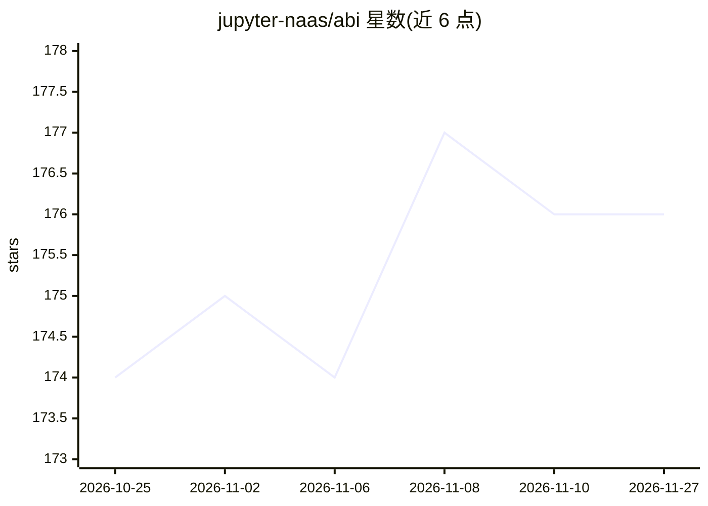

# jupyter-naas/abi

⭐ 176 · Python · MIT · 推送 2026-11-26 · [GitHub](https://github.com/jupyter-naas/abi) · [官网](https://naas.ai) · 组织维护

**开源 AI 操作系统：以本体知识图谱为底座构建企业 agent 系统**

ABI（Agentic Brain Infrastructure）将 LLM 接入组织自身的本体，提供从数据摄取到 UI 的完整栈。核心机制：基于 ISO/IEC 21838-2 BFO 本体的知识图谱、模块化组织（agent/集成/管道/工作流）、可插拔适配器（三端存储、向量库、消息总线等，社区版用 Apache Fuseki/Qdrant/PostgreSQL/NATS，企业可换云服务）、Abi 作为监督 agent 按意图分发到领域 agent。提供 Web UI、REST API 与 CLI。宣称是 Palantir 的开放替代。面向想在自有数据上构建 AI 系统的组织。

## 筛选速览

| 维度 | 判定 | 备注 |
|---|---|---|
| AI 角色 | `ai-ecosystem` | LLM/agent 周边工具 |
| 许可风险 | `permissive` | MIT |
| 部署形态 | `self-host` | docker 或自建部署 |
| 模型依赖 | — | README 未给出锁定关系 |
| 硬件要求 | — | 无带数字的原话,不猜 |
| 安装摩擦 | `low` | 无编译、无系统依赖或容器化 |
| 成熟度 | — | 结构信号不足 |

## 能力要点

- 基于 BFO 本体的知识图谱，OWL/Turtle 定义领域实体与关系
- 每个基础设施关注点抽象为 port + 可插拔 adapter，config.yaml 切换
- 每个 agent 暴露为 REST 端点，另有 Web UI 与终端 chat
- abi dev 提供无 Docker 开发运行时（SQLite/Oxigraph 本地替代）

## 适用场景

- 在组织自有知识图谱上构建可对话的领域 agent
- 接入 GitHub/Salesforce/LinkedIn 等外部 API 数据做自动化分析
- 需要可审计、可溯源数据模型的 AI 合规场景
- 自托管完整 agent 平台或用托管云服务部署

## 场景标签

`知识图谱` `工作流自动化` `Agent 框架` `数据分析` · 领域:Agent 开发

## 证据(README 行号)

> L7: ABI (Agentic Brain Infrastructure) is the open-source AI Operating System that grounds LLMs in your organization's o
> L81: - **Agents**: LLM-powered agents that reason over the knowledge graph and dispatch to the right domain capability
> L89: Each infrastructure concern is abstracted as a port with a swappable adapter. Change the adapter in `config.yaml`, 

## 星数曲线

2026-10-25 174 → 2026-11-27 176（+2）

---
*卡片 v1 · prompt 1.4 · 生成 2026-11-26 · 置信度 mid · 依据 README sha `fa8558d6b300` · [字段定义](../../DATASET.md)*
