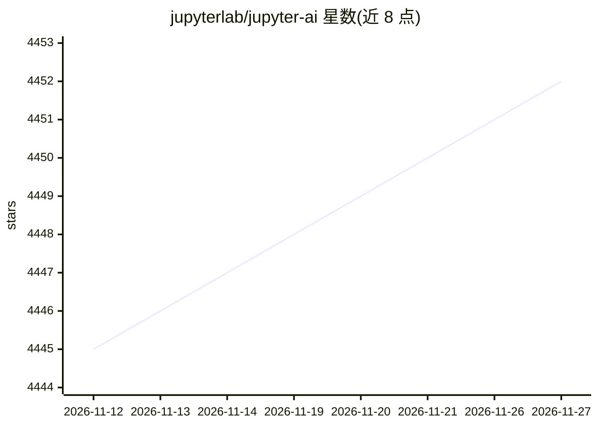

# jupyterlab/jupyter-ai

⭐ 4,452 · Python · BSD-3-Clause · 推送 2026-11-24 · [GitHub](https://github.com/jupyterlab/jupyter-ai) · [官网](https://jupyter-ai.readthedocs.io/) · 组织维护

**为 JupyterLab 接入 AI agent 的官方聊天扩展**

JupyterLab 的开源扩展，通过 Agent Client Protocol (ACP) 将 Claude、Codex、GitHub Copilot、Gemini、Goose 等编码 agent 接入笔记本环境，提供原生聊天 UI。Agent 依赖安装后自动被发现。内置 Jupyter MCP server 使 agent 可读写文件、执行终端命令、操作笔记本单元；权限系统要求 agent 在写文件或执行命令前请求用户批准。支持多并发会话、拖拽文件/单元作为上下文、多用户实时协作，并可通过 entry points API 注册自定义 AI persona 与 MCP server。含 jupyter-ai 与 jupyter-ai-core 两个包，处于 JupyterLab 组织孵化阶段。

## 筛选速览

| 维度 | 判定 | 备注 |
|---|---|---|
| AI 角色 | `ai-ecosystem` | LLM/agent 周边工具 |
| 许可风险 | `permissive` | BSD-3-Clause |
| 部署形态 | `None` |  |
| 模型依赖 | — | README 未给出锁定关系 |
| 硬件要求 | — | 无带数字的原话,不猜 |
| 安装摩擦 | `low` | 无编译、无系统依赖或容器化 |
| 成熟度 | `idea` | |

## 能力要点

- 通过 ACP 集成 Claude、Codex、Gemini 等多种 agent，依赖安装后自动检测
- 内置 Jupyter MCP server，agent 可读写文件、执行命令、操作笔记本
- 权限系统：agent 写文件/执行命令前需用户批准
- 支持自定义 MCP server 与通过 entry points API 注册自定义 persona

## 适用场景

- 在 JupyterLab 中与编码 agent 协作完成数据分析与代码编写
- 让 agent 直接操作笔记本单元与终端并保留审批控制
- 为领域工具接入自定义 MCP server 扩展 agent 能力

## 场景标签

`数据分析` · 领域:效率与自动化

## 证据(README 行号)

> L7: Jupyter AI brings agentic AI to JupyterLab. It provides a native chat UI where you can collaborate with frontier AI 
> L9: Agents in Jupyter AI can read and write files, run terminal commands, and interact with notebooks through a built-in

## 星数曲线

2026-11-12 4,445 → 2026-11-27 4,452（+7）

---
*卡片 v1 · prompt 1.4 · 生成 2026-11-17 · 置信度 high · 依据 README sha `11c36e15d3b5` · [字段定义](../../DATASET.md)*
