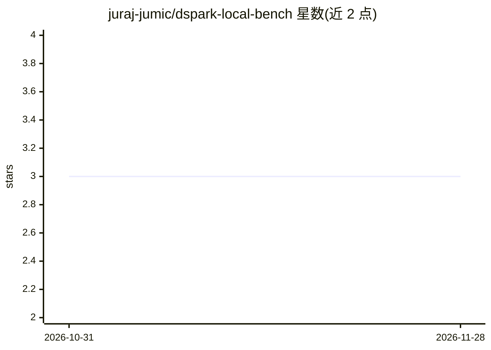

# juraj-jumic/dspark-local-bench

⭐ 3 · Python · MIT · 推送 2026-10-25 · [GitHub](https://github.com/juraj-jumic/dspark-local-bench) · 个人维护

**为单用户在消费级 GPU 上测 DSpark 投机解码收益的可复现基准**

提供一套可复现的 llama.cpp 单用户（batch-size-1）投机解码基准脚本，比较 DSpark、DFlash、小型草稿模型、n-gram 与基线解码的生成速度，覆盖 Vulkan/ROCm/CUDA/Metal 后端。安装脚本下载预编译 llama.cpp 并校验校验和，Python 包装在项目本地 .venv 中，无需编译。用户可在自己的 GPU 上运行，通过校验脚本后以 PR 贡献结果行；现有结果来自一张 AMD RX 7900 GRE 与单一模型。

## 筛选速览

| 维度 | 判定 | 备注 |
|---|---|---|
| AI 角色 | `ai-ecosystem` | LLM/agent 周边工具 |
| 许可风险 | `permissive` | MIT |
| 部署形态 | `None` |  |
| 模型依赖 | local-ok | 支持本地模型 |
| 硬件要求 | — | 无带数字的原话,不猜 |
| 安装摩擦 | `medium` | 含编译或系统依赖之一 |
| 成熟度 | — | 结构信号不足 |

## 能力要点

- 33 个设置的可复现基准矩阵，含快速筛选模式（约 10 分钟）
- 支持 Vulkan/ROCm/CUDA/Metal 后端，安装脚本下载预编译 llama.cpp，无需编译
- 结果校验脚本检查文件并剔除个人路径信息，支持 PR 贡献 GPU 数据
- 汇总与绘图脚本输出 JSON/SVG 结果

## 适用场景

- 想在自己的消费级 GPU 上测 DSpark 投机解码是否加速
- 比较 llama.cpp 内多种投机解码方法的单用户速度差异
- 向社区提交不同显卡的基准结果行

## 场景标签

`模型评测` · 领域:评测与运维

## 证据(README 行号)

> L11:  Reproducible single-user benchmarks for llama.cpp on consumer GPUs. Run them on yours and add a row.
> L87: You need Python 3.10+, git and about 15 GB of disk. The setup script downloads a prebuilt llama.cpp,
> L189: The goal is a table that answers *"does DSpark help on my GPU?"* for as many cards as possible.

## 星数曲线

2026-10-31 3 → 2026-11-28 3（+0）

---
*卡片 v1 · prompt 1.4 · 生成 2026-11-21 · 置信度 high · 依据 README sha `0c9dea47a2a7` · [字段定义](../../DATASET.md)*
