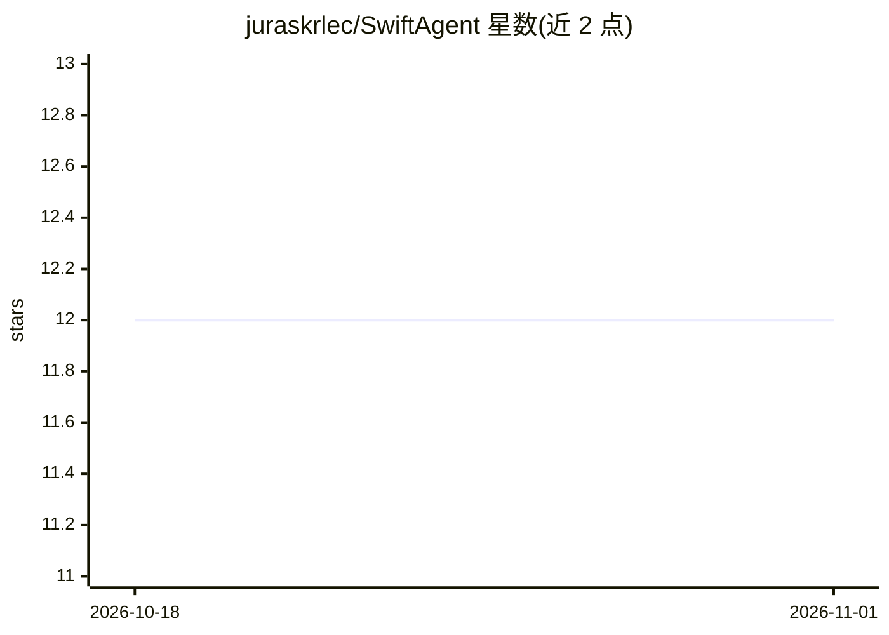

# juraskrlec/SwiftAgent

⭐ 12 · Swift · MIT · 推送 2026-07-06 · [GitHub](https://github.com/juraskrlec/SwiftAgent) · 个人维护

**Swift 原生 AI agent 构建框架，多模型接入与 RAG**

面向 Swift/iOS/macOS 开发者的自主 AI agent 构建框架：支持 Anthropic、OpenAI、Gemini 及 Apple Intelligence（设备端）四类 LLM 提供商，提供工具系统、多 agent 图工作流、RAG（内存向量库与 Pinecone、Gemini/OpenAI 嵌入）、流式输出、human-in-the-loop 中断、基于 SwiftData 的四类记忆系统（可 iCloud 同步）与多模态视觉能力。通过 Swift Package Manager 安装；Apple Intelligence 路径要求 iOS/macOS 26.0+ 且需支持的设备（iPhone 15 Pro+、M1+ Mac）。

## 筛选速览

| 维度 | 判定 | 备注 |
|---|---|---|
| AI 角色 | `ai-ecosystem` | LLM/agent 周边工具 |
| 许可风险 | `permissive` | MIT |
| 部署形态 | `None` |  |
| 模型依赖 | locked-api |  |
| 硬件要求 | — | 无带数字的原话,不猜 |
| 安装摩擦 | `low` | 无编译、无系统依赖或容器化 |
| 成熟度 | — | 结构信号不足 |

## 能力要点

- 接入 Anthropic/OpenAI/Gemini/Apple Intelligence 四类提供商，含设备端推理
- RAG 支持：内存/Pinecone 向量库、Gemini 与 OpenAI 嵌入、文档分块、MRL 维度截断
- 四种记忆类型（工作/情景/语义/用户画像），SwiftData 持久化与可选 iCloud 同步
- 多 agent 图与编排、human-in-the-loop 工具中断、流式输出

## 适用场景

- 在 iOS/macOS 应用中构建带工具调用的自主 agent
- 为 Apple 平台应用接入 RAG 知识库问答
- 编排多个专职 agent 完成研究等工作流

## 场景标签

 · 领域:LLM/Agent 开发框架

## 证据(README 行号)

> L10: A native Swift framework for building autonomous AI agents with support for multiple LLM providers, tool execution,
> L60: - **Multiple LLM Providers** - Claude (Anthropic), OpenAI (ChatGPT), Gemini (Google), and Apple Intelligence (on-de

## 星数曲线

2026-10-18 12 → 2026-11-01 12（+0）

---
*卡片 v1 · prompt 1.4 · 生成 2026-11-01 · 置信度 high · 依据 README sha `4434361e0a3e` · [字段定义](../../DATASET.md)*
