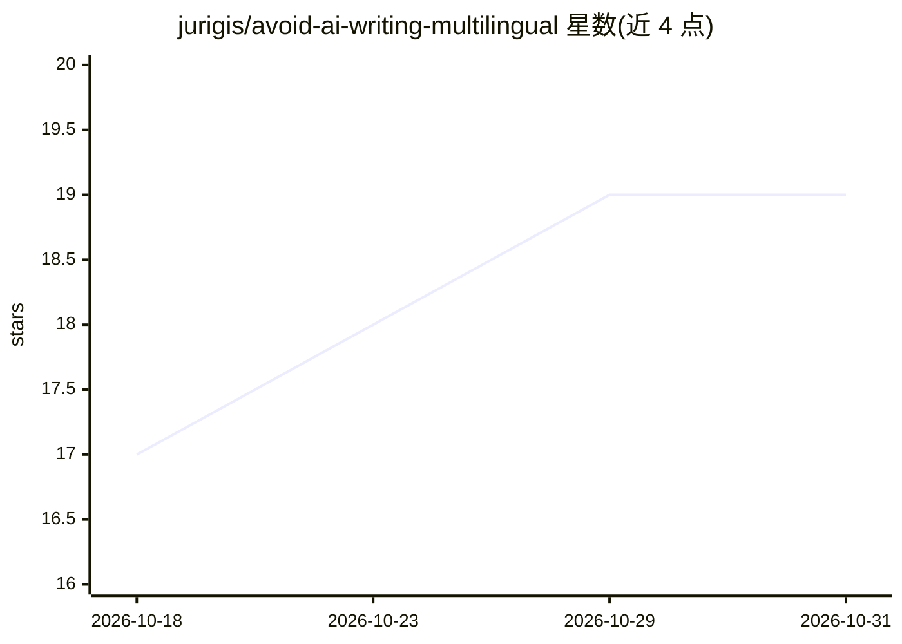

# jurigis/avoid-ai-writing-multilingual

⭐ 19 · NOASSERTION · 推送 2026-08-05 · [GitHub](https://github.com/jurigis/avoid-ai-writing-multilingual) · 个人维护

**多语言 AI 写作模式检测/改写技能文件集（德/罗/意/法/瑞典语）**

基于 Conor Bronsdon 的 avoid-ai-writing 技能扩展出的多语言 SKILL-XX.md 文件集：每个语言版本的提示词内容基于该语言中经来源记录的 LLM 过度使用模式（非英文直译），收录 40+ 模式并按 P0/P1/P2 分级。使用时将文本交给已装载技能的 AI 工具，可标记模式、改写文本并做二次检查，支持仅检测模式与按语境（博客/学术/LinkedIn 等）调节严格度。安装方式为复制 md 文件到 Claude Code skills 目录、Claude Projects、Custom GPTs、Cursor 规则等；新增语言需按 CLAUDE.md 流程做目标语言的网络来源研究并提交 PR。

## 筛选速览

| 维度 | 判定 | 备注 |
|---|---|---|
| AI 角色 | `ai-knowledge` | 知识聚合/清单类 |
| 许可风险 | `none` | NOASSERTION |
| 部署形态 | `None` |  |
| 模型依赖 | locked-api |  |
| 硬件要求 | — | 无带数字的原话,不猜 |
| 安装摩擦 | `low` | 无编译、无系统依赖或容器化 |
| 成熟度 | — | 结构信号不足 |

## 能力要点

- 5 种语言技能文件，模式均需可溯源的 LLM 统计依据
- 标记 P0/P1/P2 分级、默认改写并对改写结果二次检查
- 支持仅检测模式与按语境配置文件调节严格度
- 提供 Claude Code / Claude Projects / Custom GPTs / Cursor / Copilot 等多种装载途径

## 适用场景

- 让 AI 工具检测并去除我文本中的 AI 写作痕迹
- 不同语言（德/法/瑞典语等）内容发布前做 AI 风格审查
- 按 LinkedIn、学术、新闻稿等语境差异化调整检测严格度

## 场景标签

`提示工程` `AI 写作` · 领域:Agent 开发

## 证据(README 行号)

> L3: Language-specific versions of the avoid-ai-writing skill by Conor Bronsdon (MIT licence), extended to languages beyo
> L5: Each `SKILL-XX.md` file is grounded in **statistically documented, language-native AI writing patterns** — not trans
> L21: You give it text. It:

## 星数曲线

2026-10-18 17 → 2026-10-31 19（+2）

---
*卡片 v1 · prompt 1.4 · 生成 2026-10-28 · 置信度 high · 依据 README sha `d124ac678948` · [字段定义](../../DATASET.md)*
