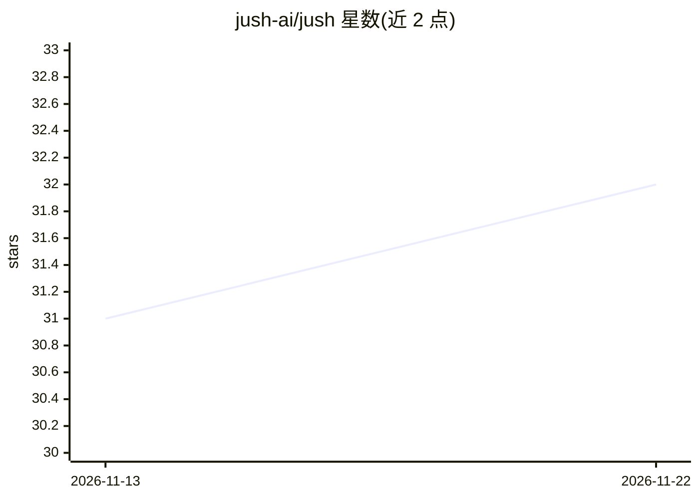

# jush-ai/jush

⭐ 32 · Rust · Apache-2.0 · 推送 2026-11-21 · [GitHub](https://github.com/jush-ai/jush) · [官网](https://jush.ai) · 组织维护

**自托管网页版 AI agent：一台服务器承载对话并调度多台机器**

Jush 是自托管在自有服务器上的网页 AI agent：浏览器访问，服务器保存全部对话，任务可在云沙箱或自有的 Mac/PC/Linux 机器上执行，关掉标签页后台继续运行并通知。架构上由 Rust 编写的服务端与 runner 组成，runner 主动外连以穿透 NAT；agent 运行时以一个 bash 兼容 shell 作为唯一工具，浏览器、其他机器与子 agent 均为 jush 命令。支持多 agent 并行、定时唤醒、凭据表单化。当前处于早期开发阶段，版本间可能有不兼容变更。

## 筛选速览

| 维度 | 判定 | 备注 |
|---|---|---|
| AI 角色 | `ai-native` | 本体是模型或模型工具 |
| 许可风险 | `permissive` | Apache-2.0 |
| 部署形态 | `self-host` | docker 或自建部署 |
| 模型依赖 | — | README 未给出锁定关系 |
| 硬件要求 | — | 无带数字的原话,不猜 |
| 安装摩擦 | `low` | 无编译、无系统依赖或容器化 |
| 成熟度 | `idea` | |

## 能力要点

- 自有 Rust 运行时以单个 bash 兼容 shell 驱动模型，浏览器/设备/子 agent 均为 jush 命令
- runner 主动外连，可在 NAT 与防火墙后工作；任务关标签页后继续运行
- 多 agent 分工并行、定时/cron/变更触发唤醒、技能扩展
- 接入 Claude/ChatGPT/Grok 订阅与 Anthropic/OpenAI/Gemini 及本地模型 API

## 适用场景

- 在自有服务器上托管一个跨手机/电脑共用的 AI agent 对话入口
- 多台机器协作完成任务：Mac 构建后在 Windows 测试，任务中途切换
- 需要真实浏览器自动化或 iOS/Android 模拟器上安装测试应用
- homelab/VPS 上自托管、数据留在自有服务器

## 场景标签

`AI 助手` `多智能体` `浏览器自动化` · 领域:Agent 开发

## 证据(README 行号)

> L14: Jush is a web-based AI agent you host on your own server. Open it in any
> L92: ## An agent built on a shell
> L123: - **The server runs the agent, runners do the work**: each runner connects

## 星数曲线

2026-11-13 31 → 2026-11-22 32（+1）

---
*卡片 v1 · prompt 1.4 · 生成 2026-11-19 · 置信度 high · 依据 README sha `6541565bd0ba` · [字段定义](../../DATASET.md)*
