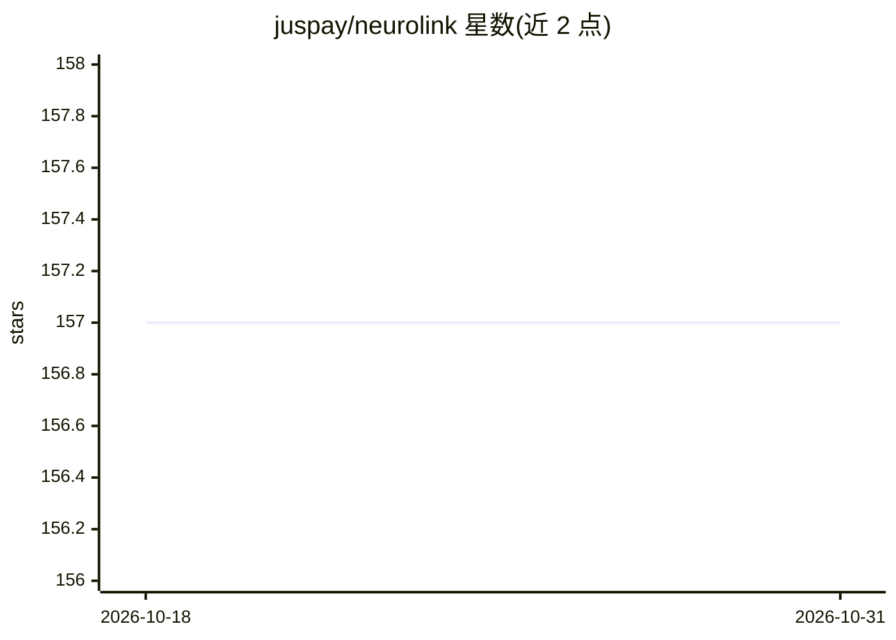

# juspay/neurolink

⭐ 157 · TypeScript · MIT · 推送 2026-10-30 · [GitHub](https://github.com/juspay/neurolink) · [官网](https://neurolink.ink) · 组织维护

**TypeScript AI 管道层：统一接口接入多提供商与三类推理**

从 Juspay 生产系统抽取的 TypeScript SDK 与 CLI：以统一接口连接 OpenAI、Anthropic、Google、AWS Bedrock、Azure、Mistral 及 Ollama、LM Studio、llama.cpp 等本地运行时，提供三种推理类型——generate/stream 产出文本，decide 产出经校准的 boolean/choice/score 判定，由 TypeSafe Jev、Laya、XOR 等决策模型驱动。内置 64 模型 132 别名的模型注册表，支持 MCP 四种传输（stdio/HTTP/SSE/WebSocket）、语音、RAG、内存与多提供商故障转移。决策模型约 68% 准确率，README 明确不适用于用户直接阅读的最终回答或不可逆操作。

## 筛选速览

| 维度 | 判定 | 备注 |
|---|---|---|
| AI 角色 | `ai-ecosystem` | LLM/agent 周边工具 |
| 许可风险 | `permissive` | MIT |
| 部署形态 | `library` | 以包/库形式分发 |
| 模型依赖 | local-ok | 支持本地模型 |
| 硬件要求 | — | 无带数字的原话,不猜 |
| 安装摩擦 | `low` | 无编译、无系统依赖或容器化 |
| 成熟度 | — | 结构信号不足 |

## 能力要点

- generate/stream/decide 三种推理类型，decide 返回校准的概率化判定
- 接入 3 种本地运行时（Ollama、LM Studio、llama.cpp）并支持单参数切换提供商
- 内置 64 模型 132 别名的模型注册表，含路由与上下文窗口检查
- MCP 支持覆盖 stdio/HTTP/SSE/WebSocket 四种传输

## 适用场景

- 在应用中用单参数切换不同 LLM 提供商并做多提供商故障转移
- 用廉价的 decide 原语做工单分派、内容初审、队列排序等批处理门控
- 把任意 MCP 兼容工具服务器接入现有 AI 流水线

## 场景标签

`模型网关` · 领域:Agent 开发

## 证据(README 行号)

> L26: **NeuroLink is the pipe layer of an AI nervous system.** Providers — OpenAI, Anthropic, Google, AWS, Azure, Mistral
> L30: **Why NeuroLink?** Three genuine inference types, not one dressed up three ways — `generate` and `stream` produce t

## 星数曲线

2026-10-18 157 → 2026-10-31 157（+0）

---
*卡片 v1 · prompt 1.4 · 生成 2026-10-22 · 置信度 high · 依据 README sha `c84a5e91dad5` · [字段定义](../../DATASET.md)*
