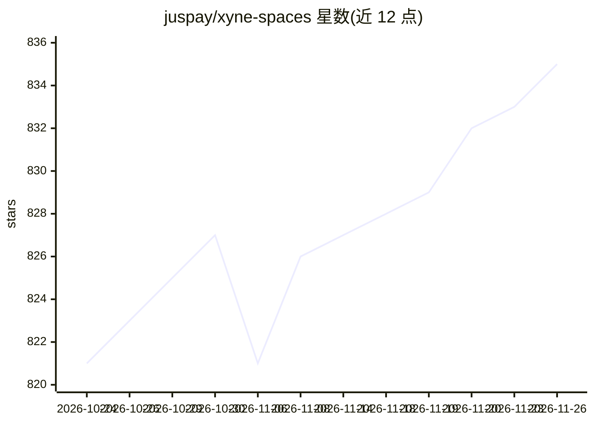

# juspay/xyne-spaces

⭐ 835 · TypeScript · Apache-2.0 · 推送 2026-11-25 · [GitHub](https://github.com/juspay/xyne-spaces) · [官网](https://xyne.ai) · 组织维护

**企业与 agent 协作的上下文层平台：统一接入、检索与代理执行**

定位为组织级「上下文层 + 协作应用」平台：通过连接器把 Slack、Google Workspace、Microsoft 365、Jira、Confluence 等来源的数据规范化存入 PostgreSQL 并索引到 Vespa，经权限感知的 API 提供给人和 agent。围绕上下文提供八个可独立采用的应用（Call/Claw/Agentic Search/Automations/客服工单/Chat/Canvas/Tickets）。agent 在无凭据的沙箱中运行，shell 执行置于 Kata Containers microVM，写操作需用户批准。本地以 git clone + pnpm 启动，依赖 Node.js 22 与容器运行时。

## 筛选速览

| 维度 | 判定 | 备注 |
|---|---|---|
| AI 角色 | `ai-enhanced` | 去掉 AI 部分产品仍成立 |
| 许可风险 | `permissive` | Apache-2.0 |
| 部署形态 | `None` |  |
| 模型依赖 | — | README 未给出锁定关系 |
| 硬件要求 | — | 无带数字的原话,不猜 |
| 安装摩擦 | `low` | 无编译、无系统依赖或容器化 |
| 成熟度 | — | 结构信号不足 |

## 能力要点

- 数据层统一权限模型：读取、写入与 agent 操作均继承调用者权限
- agent 沙箱三层隔离：运行时无密钥、shell 在 Kata QEMU microVM 且关闭出网
- Claw Auth 代理 50+ MCP 集成，工具按用户与按 agent 范围配置
- 连接器适配器化管道，实时同步与历史迁移共用同一规范化存储

## 适用场景

- 把分散在 Slack/邮件/Jira 的组织知识聚合为可检索的上下文
- 让 agent 在权限受控下做检索、摘要、工单分诊与草稿撰写
- 客服与工单流程结合自动化分诊和 SLA 跟踪
- 团队实时协作（频道、线程、画布、通话）并沉淀进同一上下文

## 场景标签

`语义搜索` `知识库管理` `工作流自动化` `RAG` · 领域:效率与自动化

## 证据(README 行号)

> L5: **The org OS.**
> L25: Automations · Customer Support Desk · Chat · Canvas · Tickets — adopted as you
> L54: - **Agentic workflows** — Claw agents, Agentic Search and Automations, all working

## 星数曲线

2026-10-24 821 → 2026-11-26 835（+14）

---
*卡片 v1 · prompt 1.4 · 生成 2026-11-24 · 置信度 mid · 依据 README sha `3d42f866afe6` · [字段定义](../../DATASET.md)*
