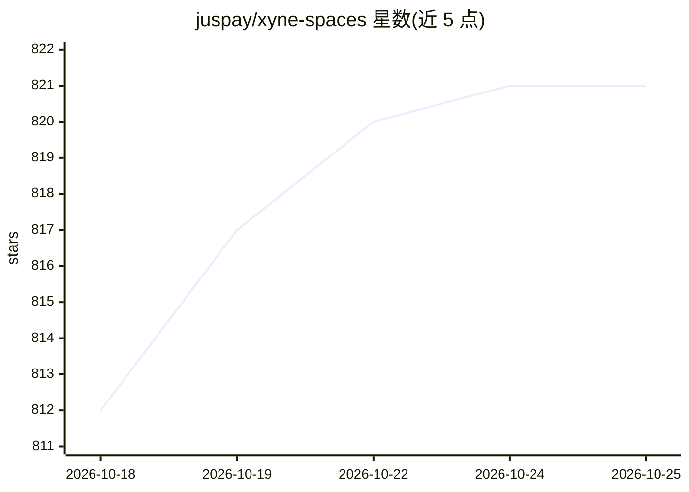

# juspay/xyne-spaces

⭐ 823 · TypeScript · Apache-2.0 · 推送 2026-10-24 · [GitHub](https://github.com/juspay/xyne-spaces) · [官网](https://xyne.ai) · 组织维护

**人与 agent 协作的组织上下文平台（自托管 Org OS）**

自托管的组织协作平台：中心是统一上下文存储，通过连接器接入 Slack、Google Workspace、Microsoft 365、Jira、Confluence 等，归一化索引后经权限感知 API 同时服务人与 agent。围绕上下文提供 8 个应用（Call、Claw agent、Agentic Search、Automations、客服台、Chat、Canvas、Tickets）。Agent 在三层隔离沙箱中运行真实代码，读操作自由、写操作需用户批准，50+ MCP 集成按用户连接情况动态可用。部署需 Node 22、pnpm 与容器运行时，一条 pnpm run up 完成本地启动。

## 筛选速览

| 维度 | 判定 | 备注 |
|---|---|---|
| AI 角色 | `ai-native` | 本体是模型或模型工具 |
| 许可风险 | `permissive` | Apache-2.0 |
| 部署形态 | `None` |  |
| 模型依赖 | — | README 未给出锁定关系 |
| 硬件要求 | — | 无带数字的原话,不猜 |
| 安装摩擦 | `low` | 无编译、无系统依赖或容器化 |
| 成熟度 | — | 结构信号不足 |

## 能力要点

- 连接器统一归一化组织上下文，检索与 agent 共享同一索引并按用户权限过滤
- Agent 三层沙箱：网关持有密钥、运行时无密钥、Bash 运行于 Kata microVM 且断网
- 写操作以用户身份执行前需在会话中点卡批准
- Claw Auth 代理 50+ MCP 集成，工具集按用户连接与 agent 分别限定

## 适用场景

- 把 Slack/Jira/Confluence 等分散的组织知识汇成一个可检索的上下文库
- 让 agent 在受控沙箱中检索、分诊工单、起草回复并代理执行外部系统操作
- 团队在 Chat/Canvas/Tickets 等应用中协作，产出沉淀进同一上下文存储

## 场景标签

`知识库管理` `Agent 框架` `语义搜索` `工作流自动化` · 领域:Agent 开发

## 证据(README 行号)

> L3: **The org OS — your organization's context layer, with collaborative apps built
> L63: Agents run inside an isolated sandbox with no credentials of their own, reach your context
> L207: |**Claw**|Sandboxed agents that read repositories, run code and call tools on connected systems; actions taken as 

## 星数曲线

2026-10-18 812 → 2026-10-25 821（+9）

---
*卡片 v1 · prompt 1.4 · 生成 2026-10-21 · 置信度 high · 依据 README sha `7fe5622e20d3` · [字段定义](../../DATASET.md)*
