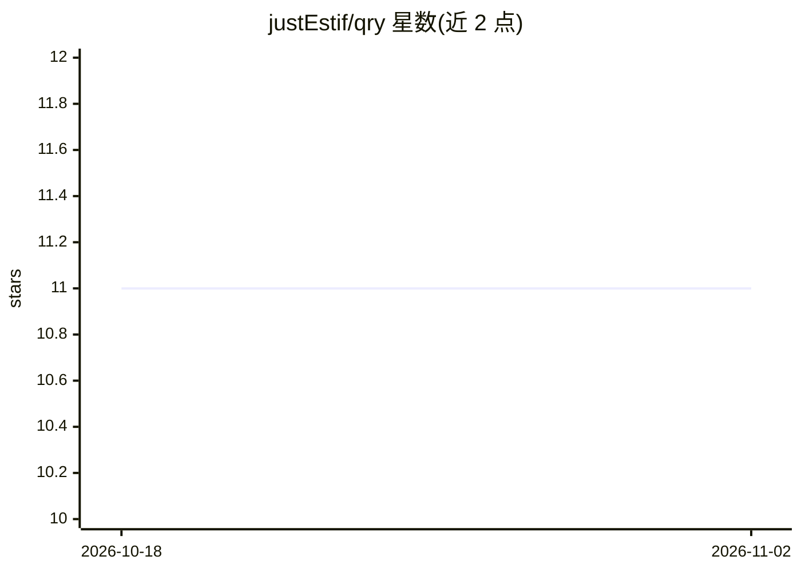

# justEstif/qry

⭐ 11 · Go · MIT · 推送 2026-04-18 · [GitHub](https://github.com/justEstif/qry) · [官网](https://justestif.github.io/qry/) · 个人维护

**面向 agent 的终端网页搜索 CLI，多适配器路由、固定输出 JSON**

用 Go 编写的终端网页搜索命令行工具：查询经可替换的内置适配器执行（Brave API、Brave/DuckDuckGo 抓取、Exa AI、GitHub、SearXNG、Stack Exchange、Wikipedia 等 8 种），结果始终输出 JSON。提供配置文件管理适配器，API key 用 ${VAR} 环境变量展开避免明文存储；支持 first（顺序尝试）与 merge（并发去重合并）两种路由模式。面向 AI agent 使用场景：提供一键安装的 agent skill 与 --agent-info 输出工具描述供 agent 自我定位。安装途径含 Homebrew、npm、mise。

## 筛选速览

| 维度 | 判定 | 备注 |
|---|---|---|
| AI 角色 | `ai-ecosystem` | LLM/agent 周边工具 |
| 许可风险 | `permissive` | MIT |
| 部署形态 | `library` | 以包/库形式分发 |
| 模型依赖 | — | README 未给出锁定关系 |
| 硬件要求 | — | 无带数字的原话,不猜 |
| 安装摩擦 | `low` | 无编译、无系统依赖或容器化 |
| 成熟度 | — | 结构信号不足 |

## 能力要点

- 8 种可替换搜索适配器（含免 key 的抓取与 Wikipedia 适配器）
- 固定 JSON 输出，适配 agent 与脚本消费
- first/merge 两种路由模式，merge 并发查询并按 URL 去重
- API key 以 ${VAR} 环境变量展开，--agent-info 不暴露已解析密钥

## 适用场景

- 让 AI agent 在终端执行网页搜索并拿到结构化结果
- 脚本中以统一 JSON 格式聚合多个搜索源
- 自托管 SearXNG 场景下作为统一搜索入口

## 场景标签

`网页抓取` · 领域:效率与自动化

## 证据(README 行号)

> L5: A terminal-native, agent-first web search CLI. Routes queries through swappable built-in adapters and always outputs
> L74: ## Agent usage

## 星数曲线

2026-10-18 11 → 2026-11-02 11（+0）

---
*卡片 v1 · prompt 1.4 · 生成 2026-11-02 · 置信度 high · 依据 README sha `bf979dc77a67` · [字段定义](../../DATASET.md)*
