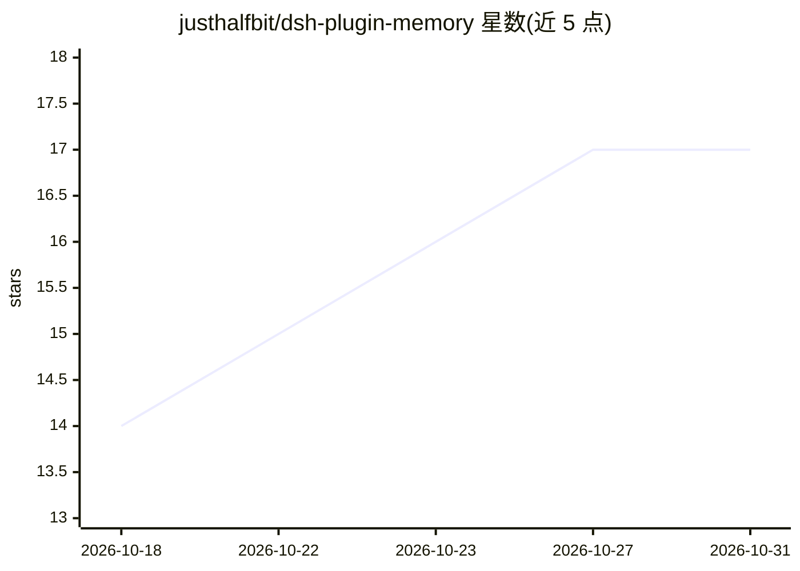

# justhalfbit/dsh-plugin-memory

⭐ 17 · JavaScript · MIT · 推送 2026-09-30 · [GitHub](https://github.com/justhalfbit/dsh-plugin-memory) · 个人维护 · 中文 README

**给 DeepSeek Harness 用户的跨会话 Markdown 记忆插件**

DeepSeek Harness (DSH) 的记忆插件：对话模型通过可见工具调用在对话中把事实、决策、教训、偏好持久化为纯 Markdown 文件，新会话自动注入。采用两层结构——主记忆文件预算内全量注入，专题文件一行索引渐进式披露、按需读取；提供可选的后台静默蒸馏（默认关闭）。记忆按项目工作目录隔离，配置热生效，附内容哈希去重、条目上限等护栏。机制对齐 Claude Code auto memory，需 DSH 0.2.0 及以上，安装依赖 pnpm。已知限制包括跨进程并发为最后写胜、记忆按项目共享不按会话隔离。

## 筛选速览

| 维度 | 判定 | 备注 |
|---|---|---|
| AI 角色 | `ai-ecosystem` | LLM/agent 周边工具 |
| 许可风险 | `permissive` | MIT |
| 部署形态 | `library` | 以包/库形式分发 |
| 模型依赖 | — | README 未给出锁定关系 |
| 硬件要求 | — | 无带数字的原话,不猜 |
| 安装摩擦 | `low` | 无编译、无系统依赖或容器化 |
| 成熟度 | — | 结构信号不足 |

## 能力要点

- 两层记忆：主文件自动注入 + 专题文件渐进式披露（一行索引、按需 memory_read）
- 模型边干边记：写入均为可见工具调用，proactivity 三档可调
- 纯 Markdown 存储：人可读、可手编、可 git 管理，按项目目录隔离
- opt-in 后台静默蒸馏（默认关），配置全部热生效

## 适用场景

- 在 DSH 项目里让对话模型跨会话记住决策、教训与偏好
- 长任务中开启后台蒸馏，静默沉淀记忆
- 用 git 管理项目记忆并手工编辑

## 场景标签

`Agent 记忆` · 领域:Agent 开发

## 证据(README 行号)

> L5: DeepSeek Harness (DSH) 的跨会话记忆插件：
> L7: 纯 Markdown 文件，并在同一项目的新会话中自动注入。机制对齐 Claude Code 官方 auto memory，
> L12: - 🧠 **两层记忆**：主记忆文件（自动注入，预算内截断）+ 专题文件（渐进式披露：只注入一行索引，正文按需加载）

## 星数曲线

2026-10-18 14 → 2026-10-31 17（+3）

---
*卡片 v1 · prompt 1.4 · 生成 2026-10-29 · 置信度 high · 依据 README sha `a6557fc2586c` · [字段定义](../../DATASET.md)*
