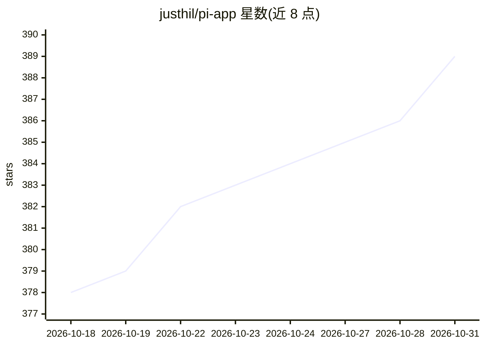

# justhil/pi-app

⭐ 389 · TypeScript · MIT · 推送 2026-10-28 · [GitHub](https://github.com/justhil/pi-app) · 个人维护 · 中文 README

**pi 编程 Agent 的桌面客户端：时间线、Git 审查与会话树**

面向使用 pi 编程 Agent 的开发者的 Electron 桌面应用：在后台 worker 中运行 pi SDK，读取与终端 CLI 相同的 ~/.pi/agent（会话、模型登录、settings.json、扩展），因此终端里开始的会话可直接在应用中继续。功能包括流式工具调用时间线、按 hunk 暂存的 Git diff 审查面板、并行会话（每会话独立 worker）、内置终端、分支切换、用量统计、会话树与上下文面板；扩展通过 36 个内置声明式适配器映射为原生 UI。附带 Android 远程应用（端到端加密、局域网连接）。支持中英文界面，Windows/macOS/Linux 提供安装包，Android 9+ 提供 APK。

## 筛选速览

| 维度 | 判定 | 备注 |
|---|---|---|
| AI 角色 | `ai-ecosystem` | LLM/agent 周边工具 |
| 许可风险 | `permissive` | MIT |
| 部署形态 | `desktop` | 安装包/桌面程序 |
| 模型依赖 | — | README 未给出锁定关系 |
| 硬件要求 | — | 无带数字的原话,不猜 |
| 安装摩擦 | `low` | 无编译、无系统依赖或容器化 |
| 成熟度 | — | 结构信号不足 |

## 能力要点

- 与终端 pi 共享 ~/.pi/agent，CLI 与桌面端可交替操作同一会话
- Git 审查面板支持按 hunk 暂存/取消暂存、行级评论回传对话
- 并行会话各跑独立 worker，可配置存活数量与回收策略
- 扩展经 36 个内置声明式适配器映射为原生 UI；Windows 支持 WSL 运行时

## 适用场景

- 给终端里的 pi 编程 Agent 换一个带时间线和 Git 审查的图形界面
- 同时推进多个 Agent 会话并随时查看用量与上下文占用
- 在手机上通过端到端加密连接继续桌面端的 Agent 会话

## 场景标签

`编码 Agent` `代码审查` · 领域:编码与开发

## 证据(README 行号)

> L5: **A desktop app for the pi coding agent.**
> L17: pi Desktop is not another agent. It runs the pi SDK in a background worker and reads the same files as the CLI — se
> L110: The renderer never talks to the SDK directly: the main process routes each request to the worker that owns the ses

## 星数曲线

2026-10-18 378 → 2026-10-31 389（+11）

---
*卡片 v1 · prompt 1.4 · 生成 2026-10-21 · 置信度 high · 依据 README sha `9ed6a1bf43b6` · [字段定义](../../DATASET.md)*
