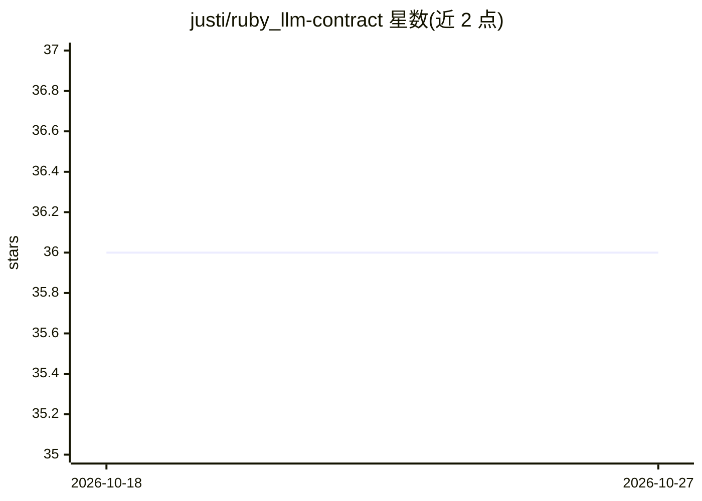

# justi/ruby_llm-contract

⭐ 36 · Ruby · MIT · 推送 2026-10-13 · [GitHub](https://github.com/justi/ruby_llm-contract) · 个人维护

**为 ruby_llm 提供 LLM 输出契约校验、重试升级与回归评测的 Ruby gem**

封装 RubyLLM::Chat 的运行时契约层：以 Step 类声明 prompt、输出 JSON schema 与业务规则 validate，校验失败时按 retry_policy 逐级升级到更强模型重试；提供 max_cost/max_input 预检拒绝、逐调用成本跟踪（含 prompt-cache 计价）与 define_eval 回归数据集基线，可在 CI 中阻断提示词或模型变更导致的质量回退。兼容任意 ruby_llm 提供商（OpenAI/Anthropic/Gemini 等），要求 Ruby ≥ 3.2 与 ruby_llm 2.1.1+。以 Ruby gem 形式提供，含 Rails 集成、RSpec/Minitest stub 与多步 pipeline。

## 筛选速览

| 维度 | 判定 | 备注 |
|---|---|---|
| AI 角色 | `ai-ecosystem` | LLM/agent 周边工具 |
| 许可风险 | `permissive` | MIT |
| 部署形态 | `None` |  |
| 模型依赖 | local-ok | 支持本地模型 |
| 硬件要求 | — | 无带数字的原话,不猜 |
| 安装摩擦 | `low` | 无编译、无系统依赖或容器化 |
| 成熟度 | — | 结构信号不足 |

## 能力要点

- 输出 schema + 业务规则 validate，失败自动升级到更强模型重试
- define_eval 回归数据集基线，CI 门禁阻断质量回退
- max_cost/max_input 预检拒绝与逐调用成本跟踪，未知成本 fail-closed
- 多步 pipeline、多模态输入与 Rails/Sidekiq 集成

## 适用场景

- 给生产环境 LLM 调用加输出契约，阻断 schema 合法但内容错误的结果
- 在 CI 中对冻结数据集跑回归评测，拦截提示词改动导致的质量下降
- 用实证方法挑选最便宜的可行模型升级链并控制调用成本

## 场景标签

`提示工程` `模型评测` `LLM 可观测性` · 领域:Agent 开发

## 证据(README 行号)

> L5: Your eval passed. Prod broke anyway? This gem wraps `RubyLLM::Chat` with input/output contracts, business-rule valid
> L7: `ruby_llm` handles the HTTP side (rate limits, timeouts, streaming, tool calls, embeddings). This gem handles what t

## 星数曲线

2026-10-18 36 → 2026-10-27 36（+0）

---
*卡片 v1 · prompt 1.4 · 生成 2026-10-25 · 置信度 high · 依据 README sha `6cbf2b1eae9f` · [字段定义](../../DATASET.md)*
