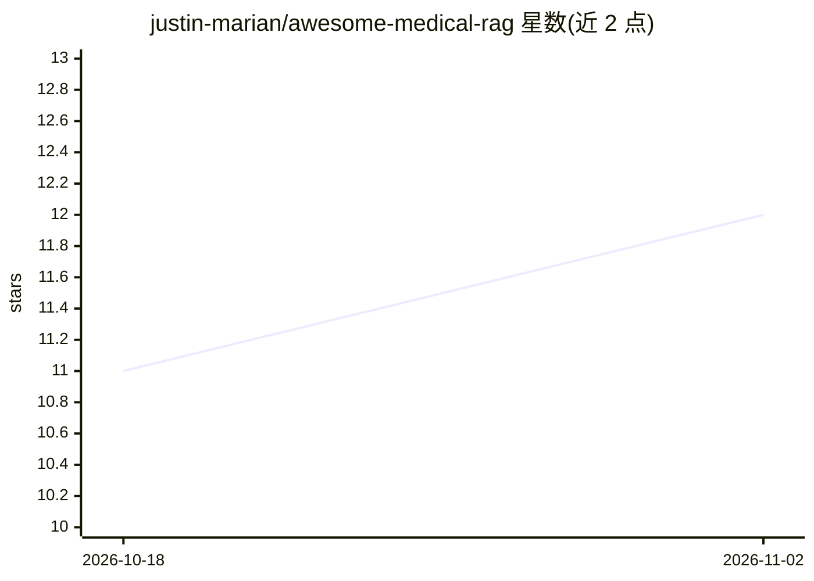

# justin-marian/awesome-medical-rag

⭐ 12 · NOASSERTION · 推送 2026-06-25 · [GitHub](https://github.com/justin-marian/awesome-medical-rag) · 个人维护

**医学 QA/RAG 论文与数据集策展清单（250+ 条）**

Markdown 编写的医学 AI 研究资源清单：收录 250+ 篇论文、数据集与基准，覆盖医学 RAG、GraphRAG/知识图谱、临床/EHR 检索增强、多语言医学 LLM（中/日/法/西/越/葡等）与安全评估方向。条目按方法与领域分类组织，附研究路线图（Research Map）给出各方向的推荐起点论文与理由；面向医学 NLP 与临床 AI 方向的研究者与开发者。以纯文档形式提供，CC BY 4.0 许可，通过 PR 接收贡献。

## 筛选速览

| 维度 | 判定 | 备注 |
|---|---|---|
| AI 角色 | `ai-knowledge` | 知识聚合/清单类 |
| 许可风险 | `none` | NOASSERTION |
| 部署形态 | `None` |  |
| 模型依赖 | — | README 未给出锁定关系 |
| 硬件要求 | — | 无带数字的原话,不猜 |
| 安装摩擦 | `low` | 无编译、无系统依赖或容器化 |
| 成熟度 | — | 结构信号不足 |

## 能力要点

- 收录 250+ 医学 RAG/临床 LLM 论文、数据集与基准
- 按 Medical RAG/GraphRAG/临床 EHR/安全/多语言等主题组织
- Research Map 给出各研究方向推荐起点论文
- 覆盖中/日/法/西/越/葡等多语言医学模型条目

## 适用场景

- 查找医学 RAG 与临床 LLM 的入门综述与基准论文
- 按语言（中/日/法/西等）检索医学领域模型研究
- 调研 GraphRAG 与知识图谱增强的医学 QA 方案

## 场景标签

`精选清单` `科研工具` · 领域:学习与行业

## 证据(README 行号)

> L14: > **The Definitive Knowledge Hub for Medical AI**
> L16: > Welcome to a meticulously curated collection of **250+** research papers, datasets, and benchmarks. This reposito

## 星数曲线

2026-10-18 11 → 2026-11-02 12（+1）

---
*卡片 v1 · prompt 1.4 · 生成 2026-11-02 · 置信度 high · 依据 README sha `3642e7c54f44` · [字段定义](../../DATASET.md)*
