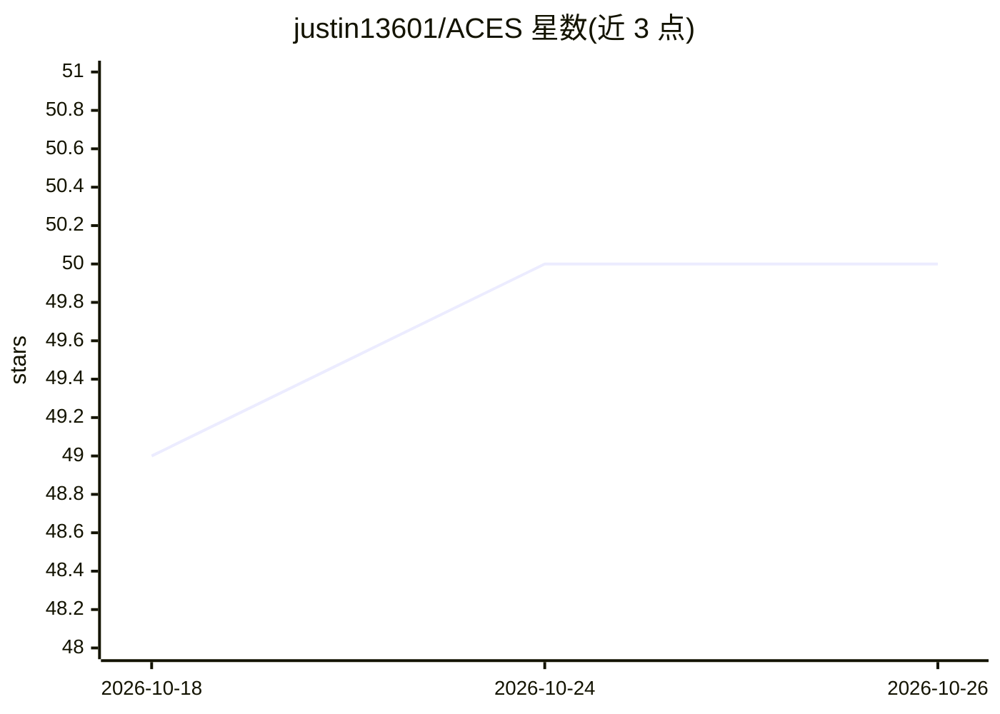

# justin13601/ACES

⭐ 50 · Python · MIT · 推送 2026-09-04 · [GitHub](https://github.com/justin13601/ACES) · [官网](https://eventstreamaces.readthedocs.io/en/latest/) · 个人维护

**从事件流 EHR 数据中按 YAML 配置提取任务队列的 Python 库**

ACES 是一个 Python 库，面向研究人员与开发者，用于从事件流格式的时间序列数据（如电子健康记录 EHR）中提取任务特定队列。用户通过 YAML 任务配置文件定义谓词（plain/derived/特殊谓词）与时间或事件界定的窗口及触发事件，无需复杂数据框查询即可筛选满足条件的受试者并输出窗口边界与谓词计数。直接支持 MEDS 与 ESGPT 两种数据标准，也支持任意 schema 的自制谓词数据框；提供 aces-cli 命令行与 Python API 两种执行方式，附 6 个常见任务的示例配置。

## 筛选速览

| 维度 | 判定 | 备注 |
|---|---|---|
| AI 角色 | `ai-ecosystem` | LLM/agent 周边工具 |
| 许可风险 | `permissive` | MIT |
| 部署形态 | `library` | 以包/库形式分发 |
| 模型依赖 | — | README 未给出锁定关系 |
| 硬件要求 | — | 无带数字的原话,不猜 |
| 安装摩擦 | `low` | 无编译、无系统依赖或容器化 |
| 成熟度 | — | 结构信号不足 |

## 能力要点

- YAML 配置定义谓词、触发事件与窗口，输出满足条件的受试者队列
- 直接支持 MEDS 与 ESGPT 数据标准，并兼容任意 schema 的谓词数据框
- 提供 plain/derived/特殊谓词（_ANY_EVENT/_RECORD_START/_RECORD_END）表达语言
- 提供 aces-cli 与 Python API 两种执行方式及 6 个示例任务配置

## 适用场景

- 从 EHR 数据集中提取特定病种或人群的回顾性研究队列
- 为基础模型训练定义 EHR 数据子集
- 按任务（而非数据）构建基准测试队列（MEDS-DEV）

## 场景标签

`科研工具` · 领域:学习与行业

## 证据(README 行号)

> L28: Automatic Cohort Extraction System (ACES) is a library that streamlines the extraction of task-specific cohorts fro
> L30: There are diverse applications in healthcare and beyond. For instance, researchers can effortlessly define subsets 

## 星数曲线

2026-10-18 49 → 2026-10-26 50（+1）

---
*卡片 v1 · prompt 1.4 · 生成 2026-10-24 · 置信度 high · 依据 README sha `8be813f2c003` · [字段定义](../../DATASET.md)*
