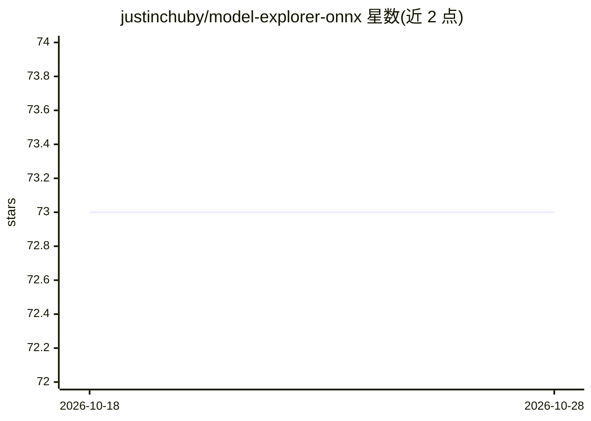

# justinchuby/model-explorer-onnx

⭐ 73 · Python · MIT · 推送 2026-10-22 · [GitHub](https://github.com/justinchuby/model-explorer-onnx) · [官网](http://onnxvis.justinchuby.com/) · 个人维护

**为 Model Explorer 提供 ONNX 模型可视化的适配器**

google-ai-edge/model-explorer 的 ONNX 适配器，以 Python 包发布到 PyPI，将 ONNX 模型转换并加载进 Model Explorer 进行图结构可视化；对隐式捕获值（Loop/Scan）与 If 分支做专门的可视化处理以展示全部值依赖。附带一个基于 Pyodide 的纯浏览器静态 Web 应用，可转换并渲染 ONNX 模型，且可安装为 PWA 桌面应用。另支持可视化 PyTorch ONNX 导出器（dynamo=True）的精度校验结果（需 PyTorch 2.7+）。面向需要检视 ONNX 模型结构的开发者。

## 筛选速览

| 维度 | 判定 | 备注 |
|---|---|---|
| AI 角色 | `ai-ecosystem` | LLM/agent 周边工具 |
| 许可风险 | `permissive` | MIT |
| 部署形态 | `library` | 以包/库形式分发 |
| 模型依赖 | — | README 未给出锁定关系 |
| 硬件要求 | — | 无带数字的原话,不猜 |
| 安装摩擦 | `low` | 无编译、无系统依赖或容器化 |
| 成熟度 | — | 结构信号不足 |

## 能力要点

- 将 ONNX 模型接入 Model Explorer 进行图可视化
- 浏览器内运行的静态 Web 应用（Pyodide + JS），支持 PWA 安装
- 可视化 PyTorch ONNX 导出器（dynamo=True）的数值校验结果
- 对隐式捕获与 If 子图做专门的可视化表示处理

## 适用场景

- 查看与调试 ONNX 模型的计算图结构
- 在浏览器中无需本地环境即可可视化 ONNX 模型
- 对比 PyTorch 导出 ONNX 前后的数值精度并可视化差异

## 场景标签

`模型评测` · 领域:评测与运维

## 证据(README 行号)

> L5: ONNX Adapter for google-ai-edge/model-explorer
> L14: pip install --upgrade model-explorer-onnx

## 星数曲线

2026-10-18 73 → 2026-10-28 73（+0）

---
*卡片 v1 · prompt 1.4 · 生成 2026-10-24 · 置信度 mid · 依据 README sha `2f7389d7706b` · [字段定义](../../DATASET.md)*
