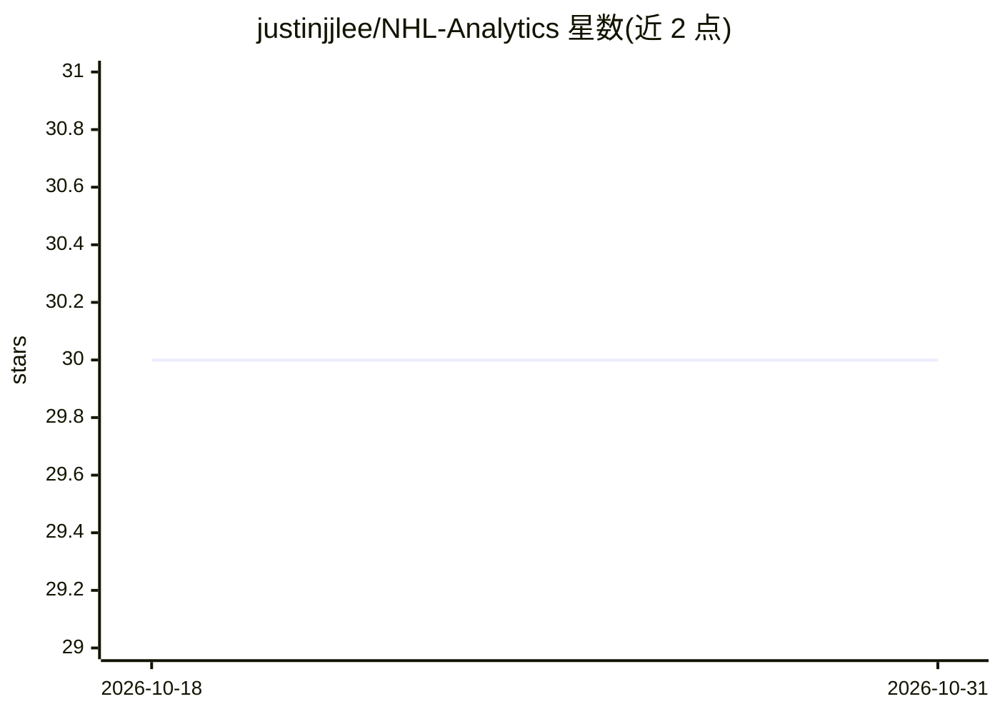

# justinjjlee/NHL-Analytics

⭐ 30 · Python · MIT · 推送 2026-10-30 · [GitHub](https://github.com/justinjjlee/NHL-Analytics) · 个人维护

**NHL 冰球数据端到端分析平台与公开数据湖仓**

端到端体育分析平台 Rinklytics：从 NHL API 采集并清洗数据，构建覆盖 2013–2026 赛季的公开数据湖仓（比分、博彩赔率、球员出场、逐事件与身体冲撞序列），在 Databricks 上做分布式处理与建模（PyTorch 状态空间模型、Kalman 滤波、生存分析），并通过 Hugging Face Spaces 上的 Streamlit 应用可视化。本地可用 uv 安装依赖运行，或以 Docker 容器在 1901 端口运行。深度文章发布于 Medium。

## 筛选速览

| 维度 | 判定 | 备注 |
|---|---|---|
| AI 角色 | `ai-native` | 本体是模型或模型工具 |
| 许可风险 | `permissive` | MIT |
| 部署形态 | `self-host` | docker 或自建部署 |
| 模型依赖 | — | README 未给出锁定关系 |
| 硬件要求 | — | 无带数字的原话,不猜 |
| 安装摩擦 | `low` | 无编译、无系统依赖或容器化 |
| 成熟度 | — | 结构信号不足 |

## 能力要点

- 覆盖 2013–2026 赛季的多季面板数据集，托管于 Hugging Face Datasets
- GitHub Actions 每日自动采集 NHL API 并同步 Parquet 数据
- PyTorch 状态空间模型与 Kalman 滤波分析身体冲撞的动量效应
- Streamlit 交互式仪表盘，本地原生或 Docker 两种运行方式

## 适用场景

- 研究 NHL 球队战术、球员生涯与博彩市场效率
- 直接复用公开清洗后的 NHL 多季面板数据集
- 本地运行或以 Docker 部署冰球数据仪表盘

## 场景标签

`数据分析` · 领域:效率与自动化

## 证据(README 行号)

> L15: **NHL Analytics (Rinklytics)** is an end-to-end sports analytics platform and public open-data lakehouse. It collec
> L36: |**Big Data Engineering**|**Databricks Workspaces**|Distributed compute and ML pipelines for processing multi-milli

## 星数曲线

2026-10-18 30 → 2026-10-31 30（+0）

---
*卡片 v1 · prompt 1.4 · 生成 2026-10-26 · 置信度 mid · 依据 README sha `38c264256c7d` · [字段定义](../../DATASET.md)*
