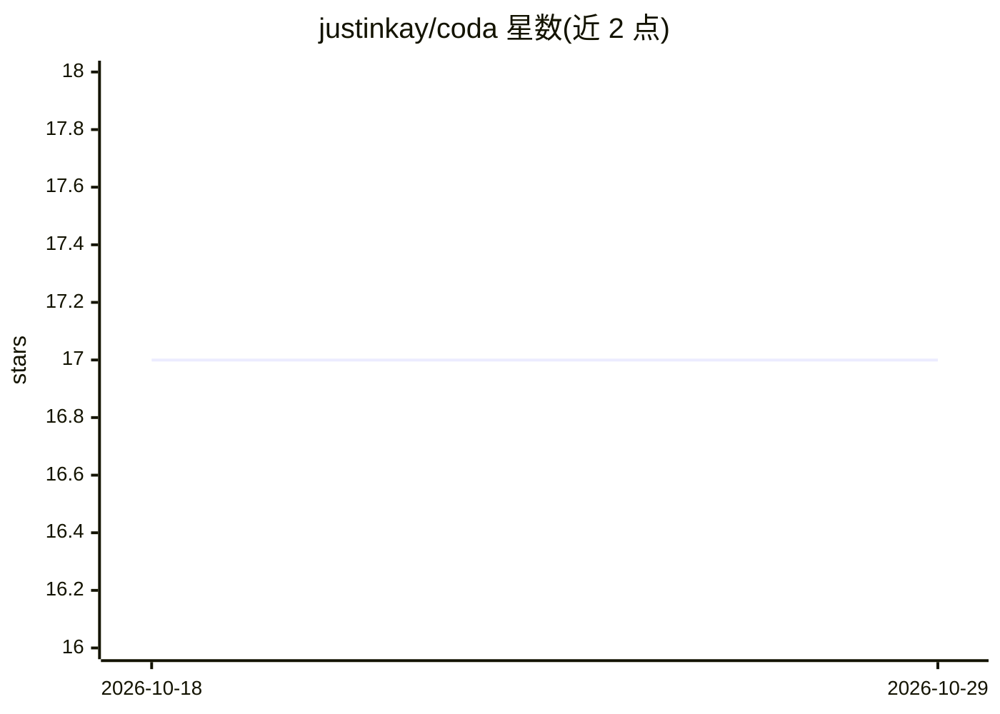

# justinkay/coda

⭐ 17 · Python · 推送 2026-09-15 · [GitHub](https://github.com/justinkay/coda) · 个人维护

**减少标注量的主动模型选择方法（ICCV 2025）**

ICCV 2025 Highlight 论文 CODA 的官方实现：针对候选模型池（如 HuggingFace 上大量现成模型）的选型问题，利用模型间一致性与分歧引导标签获取过程，并通过贝叶斯推断随信息积累更新对各模型的信念，以更少标注量找出最优模型。提供 pip 可编辑安装方式、数据集下载（3.25GB）与在 CIFAR10-high 等任务上运行实验的命令行入口。面向机器学习研究者与计算机视觉从业者复现和扩展该方法。

## 筛选速览

| 维度 | 判定 | 备注 |
|---|---|---|
| AI 角色 | `ai-ecosystem` | LLM/agent 周边工具 |
| 许可风险 | `none` | — |
| 部署形态 | `library` | 以包/库形式分发 |
| 模型依赖 | — | README 未给出锁定关系 |
| 硬件要求 | — | 无带数字的原话,不猜 |
| 安装摩擦 | `medium` | 含编译或系统依赖之一 |
| 成熟度 | — | 结构信号不足 |

## 能力要点

- 利用模型池内共识与分歧引导标签获取
- 贝叶斯推断持续更新模型优劣信念
- 提供可复现的主动模型选择实验入口（main.py 多种子运行）

## 适用场景

- 我需要从大量候选模型中低成本选出适合任务的最优模型
- 复现或对比 ICCV 2025 CODA 论文实验
- 研究标注预算受限下的模型选择方法

## 场景标签

 · 领域:机器学习方法/模型选择

## 证据(README 行号)

> L7: We introduce CODA , a co nsensus- d riven method for a ctive model selection, to answer this question as efficiently
> L11:  CODA uses the consensus and disagreement between models in the candidate pool to guide
> L12: the label acquisition process, and Bayesian inference to update beliefs about which model is best as more informati

## 星数曲线

2026-10-18 17 → 2026-10-29 17（+0）

---
*卡片 v1 · prompt 1.4 · 生成 2026-10-29 · 置信度 high · 依据 README sha `6af36468b144` · [字段定义](../../DATASET.md)*
