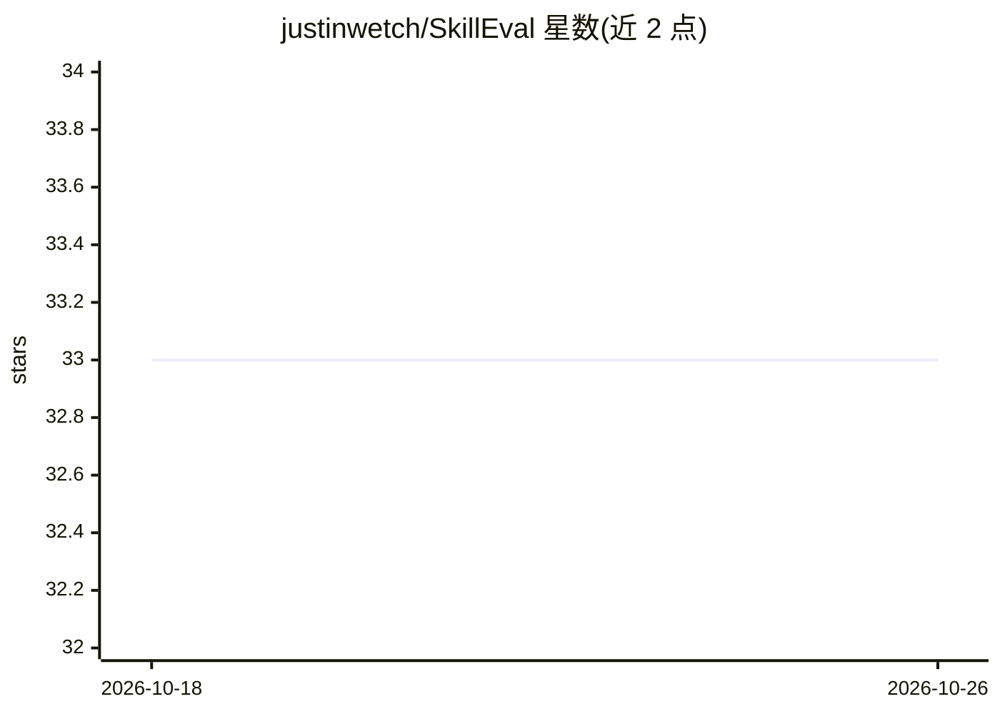

# justinwetch/SkillEval

⭐ 33 · JavaScript · MIT · 推送 2026-09-24 · [GitHub](https://github.com/justinwetch/SkillEval) · 个人维护

**AI Skill 的 A/B 评测工作台：双技能跑批并打分**

面向 Agent Skill 开发者的可视化评测工具：上传两个单文件技能（.md/.txt）或 zip 格式的 Agent Skill 包，通过 AI 自动生成评测标准与测试提示词，将提示词批量跑过两个技能获得对照输出，再由 AI Judge 按标准逐项打分并给出胜负汇总与明细。支持 Anthropic、OpenAI、Gemini、xAI 四家模型，输出模型与评审模型可分别设置。可视化评测需另起本地 runner 用 Puppeteer 截图。源码运行，需 Node.js 18+ 与至少一家 provider 的 API key。

## 筛选速览

| 维度 | 判定 | 备注 |
|---|---|---|
| AI 角色 | `ai-ecosystem` | LLM/agent 周边工具 |
| 许可风险 | `permissive` | MIT |
| 部署形态 | `library` | 以包/库形式分发 |
| 模型依赖 | locked-api |  |
| 硬件要求 | — | 无带数字的原话,不猜 |
| 安装摩擦 | `low` | 无编译、无系统依赖或容器化 |
| 成熟度 | — | 结构信号不足 |

## 能力要点

- 两个技能文件/包的 A/B 对比评测，输出模型与 Judge 模型分离
- AI 自动从技能生成评测标准与测试提示词
- 支持 .zip Agent Skill 包（含 SKILL.md 及引用、脚本、资产）
- 覆盖 Anthropic/OpenAI/Gemini/xAI 多家模型，provider 各自配 key

## 适用场景

- 对比两个版本的 Skill 看哪个在测试提示集上表现更好
- 为自写的 Claude Skill 自动生成评测标准和测试题
- 逐标准查看两个 Skill 输出的得分差异

## 场景标签

`模型评测` · 领域:评测与运维

## 证据(README 行号)

> L3: A visual workbench for A/B testing AI skills. Upload two Agent Skill packages or single-file skills, run them throug
> L33: **Configure** — Upload two single-file skills or zipped Agent Skill packages (A and B) and set up your evaluation. 
> L55: **Results** — After generation, run the judge to score both outputs against your criteria. The summary view shows o

## 星数曲线

2026-10-18 33 → 2026-10-26 33（+0）

---
*卡片 v1 · prompt 1.4 · 生成 2026-10-25 · 置信度 high · 依据 README sha `9725529fee14` · [字段定义](../../DATASET.md)*
