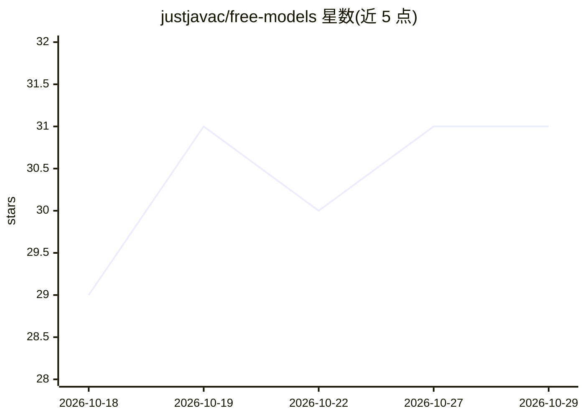

# justjavac/free-models

⭐ 31 · TypeScript · MIT · 推送 2026-10-12 · [GitHub](https://github.com/justjavac/free-models) · [官网](https://models.denohub.com) · 个人维护 · 中文 README

**只收录免费额度 LLM 中转站的目录站，附可编程数据端点**

收录提供免费额度（注册赠送、每日签到、部分模型免费、无限免费）的 LLM 中转站/聚合网关的策展目录：可按中转站浏览免费档，也可按模型反查其可用免费渠道，每条记录含上下文、输出上限、推理/工具调用/结构化输出与价格。数据以静态 JSON 端点开放（api/models/catalog 三种视图，部署时生成、短时缓存），并提供 llms.txt 规范文件供 AI 代理直接读取。站点基于 Next.js + TypeScript 静态生成，前端仅内存检索。

## 筛选速览

| 维度 | 判定 | 备注 |
|---|---|---|
| AI 角色 | `ai-knowledge` | 知识聚合/清单类 |
| 许可风险 | `permissive` | MIT |
| 部署形态 | `None` |  |
| 模型依赖 | — | README 未给出锁定关系 |
| 硬件要求 | — | 无带数字的原话,不猜 |
| 安装摩擦 | `low` | 无编译、无系统依赖或容器化 |
| 成熟度 | — | 结构信号不足 |

## 能力要点

- 只收录有免费档的中转站/聚合网关
- 按模型反查可用免费渠道，含上下文/价格/能力规格
- 静态 JSON 数据端点（api/models/catalog）可编程取用
- 提供 /llms.txt 与 /llms-full.txt 供 LLM/AI 代理读取

## 适用场景

- 我想找有免费额度的 LLM 中转站来试用模型
- 查某个模型（如 DeepSeek、Kimi）能在哪些中转站免费使用
- 用脚本或 AI 代理拉取目录数据做自动化选型

## 场景标签

`精选清单` · 领域:学习与行业

## 证据(README 行号)

> L3: 一个**只收录提供免费额度的 LLM 中转站 / 聚合网关**。用来帮你快速找到：哪个中转站可以免费白嫖额度、哪个模型能在哪些中转站免费使用。
> L16: curl https://models.denohub.com/api.json        # 按中转站 id 为键

## 星数曲线

2026-10-18 29 → 2026-10-29 31（+2）

---
*卡片 v1 · prompt 1.4 · 生成 2026-10-26 · 置信度 high · 依据 README sha `48da2a1b59e4` · [字段定义](../../DATASET.md)*
