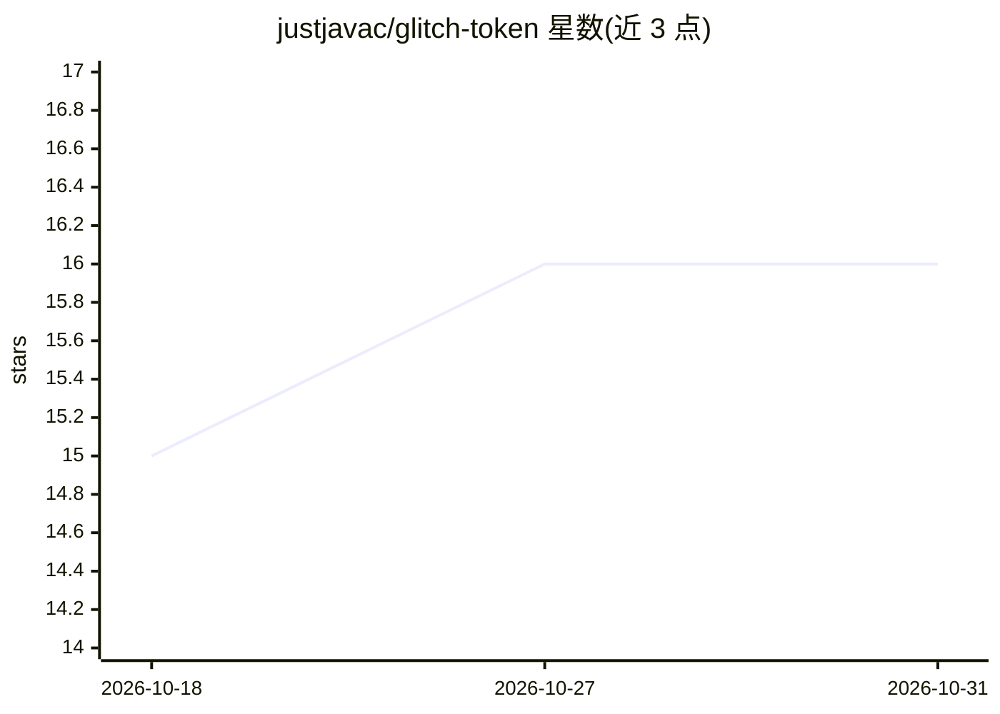

# justjavac/glitch-token

⭐ 16 · TypeScript · MIT · 推送 2026-07-31 · [GitHub](https://github.com/justjavac/glitch-token) · [官网](https://glitch-token.jjc.fun) · 个人维护 · 中文 README

**LLM 故障 token 资料库：103 条异常 token 考据与检索**

收录 103 个已公开记录的大模型故障 token，覆盖 22 个模型系列（GPT-2/3、GPT-3.5/4、o200k、Llama、Qwen、Gemma、Mistral 等）。每条附具体异常表现、来源链接与可复现链接（分享对话、演示帖、实验数据、复现代码），支持按模型与行为类型（欠训练验证/不可说/多义性/指纹）筛选。提供中英双语在线站点，并通过 /tokens.json、/llms.txt 等端点无需 API key 开放程序化访问，另附用指纹 token 鉴别中转 API 的验证指南。

## 筛选速览

| 维度 | 判定 | 备注 |
|---|---|---|
| AI 角色 | `ai-knowledge` | 知识聚合/清单类 |
| 许可风险 | `permissive` | MIT |
| 部署形态 | `None` |  |
| 模型依赖 | — | README 未给出锁定关系 |
| 硬件要求 | — | 无带数字的原话,不猜 |
| 安装摩擦 | `low` | 无编译、无系统依赖或容器化 |
| 成熟度 | — | 结构信号不足 |

## 能力要点

- 103 个故障 token，覆盖 22 个模型系列
- 逐条考据：异常表现+来源+复现链接
- /tokens.json、/llms.txt 端点无需 API key 程序化访问
- 指纹 token 鉴别中转 API 是否掺水的验证指南

## 适用场景

- 查找某模型的已知异常 token 及其复现方式
- 调试分词器或模型异常输出时对照排查
- 用指纹 token 验证中转 API 返回的模型是否被替换

## 场景标签

`精选清单` · 领域:学习与行业

## 证据(README 行号)

> L3: > 大模型故障 token（glitch token）资料库：**103 个**已公开记录的异常 token，覆盖 **22 个模型系列**，每条附具体异常表现、来源与复现链接。
> L27: - **22 个模型系列**：GPT-2/3、GPT-3.5/4、o200k、Llama、Qwen、Gemma、Mistral……按模型聚合浏览

## 星数曲线

2026-10-18 15 → 2026-10-31 16（+1）

---
*卡片 v1 · prompt 1.4 · 生成 2026-10-30 · 置信度 high · 依据 README sha `a2f77e1cf4bf` · [字段定义](../../DATASET.md)*
