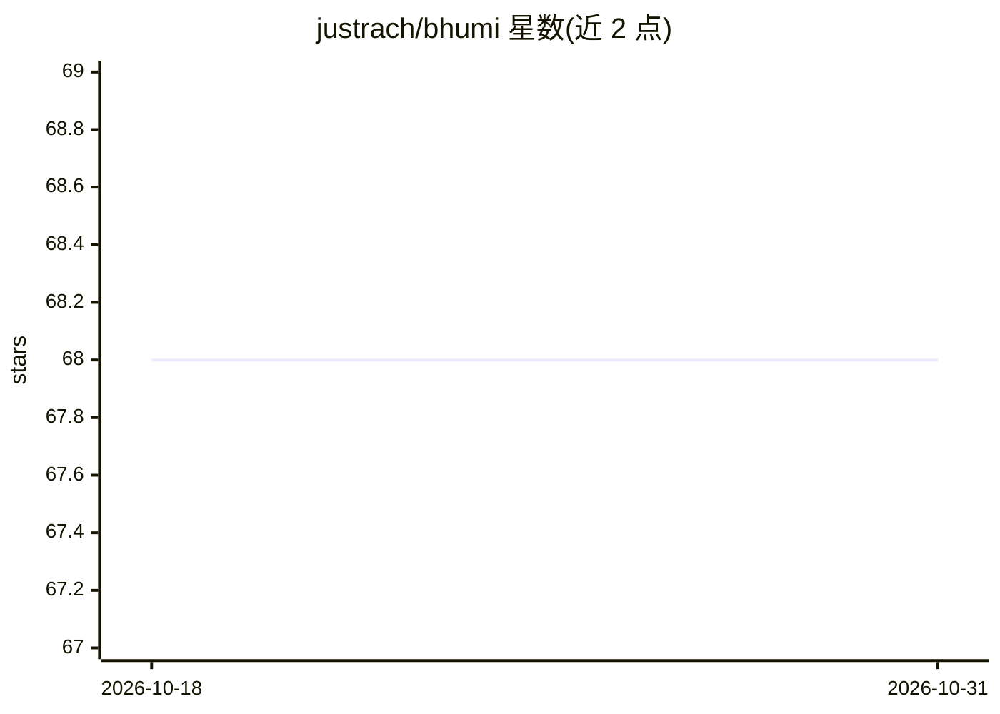

# justrach/bhumi

⭐ 68 · Python · Apache-2.0 · 推送 2026-01-22 · [GitHub](https://github.com/justrach/bhumi) · [官网](https://bhumi.trilok.ai) · 个人维护

**Rust 编写的 Python AI 推理客户端库，统一接入多家 LLM API**

以 Rust 实现核心、供 Python 调用的 LLM API 客户端库，通过 provider/model 格式统一访问 OpenAI、Anthropic、Gemini、Groq、Cerebras、SambaNova、OpenRouter、Mistral、Cohere 等 9 家以上提供商，支持聊天、流式、异步、工具调用、图像分析与结构化输出。内置连接池与重试机制，附预训练 MAP-Elites 缓冲配置用于缓冲区调优，另提供基于 Mistral 的 OCR 与文档解析方法（client.ocr()、client.upload_file()）。以 pip 预编译 wheel 分发，覆盖 Linux/macOS/Windows 与 Python 3.8-3.12，无需本地 Rust 编译器。

## 筛选速览

| 维度 | 判定 | 备注 |
|---|---|---|
| AI 角色 | `ai-ecosystem` | LLM/agent 周边工具 |
| 许可风险 | `permissive` | Apache-2.0 |
| 部署形态 | `library` | 以包/库形式分发 |
| 模型依赖 | locked-api |  |
| 硬件要求 | — | 无带数字的原话,不猜 |
| 安装摩擦 | `low` | 无编译、无系统依赖或容器化 |
| 成熟度 | — | 结构信号不足 |

## 能力要点

- 统一 provider/model 格式接入 9+ 家 AI 提供商
- Rust 实现核心，提供聊天/流式/异步/工具调用/视觉能力
- 内置 OCR：client.ocr() 支持 PDF/JPEG/PNG、结构化 JSON 输出与边界框
- 预编译 wheel 分发，支持 Python 3.8-3.12 与 Free-Threaded Python 3.13+

## 适用场景

- 在 Python 高并发服务中统一调用多家 LLM API
- 对 PDF 等文档执行 OCR 并抽取结构化字段
- 通过单一客户端在多个网关（Groq/OpenRouter/SambaNova）间访问模型

## 场景标签

`模型网关` `OCR` · 领域:Agent 开发

## 证据(README 行号)

> L10: Bhumi is the fastest AI inference client, built with Rust for Python. It is designed to maximize performance, effic
> L161: - Supported providers: `openai`, `anthropic`, `gemini`, `groq`, `sambanova`, `openrouter`, `cerebras`, `mistral`, 

## 星数曲线

2026-10-18 68 → 2026-10-31 68（+0）

---
*卡片 v1 · prompt 1.4 · 生成 2026-10-24 · 置信度 high · 依据 README sha `7c587fac8458` · [字段定义](../../DATASET.md)*
