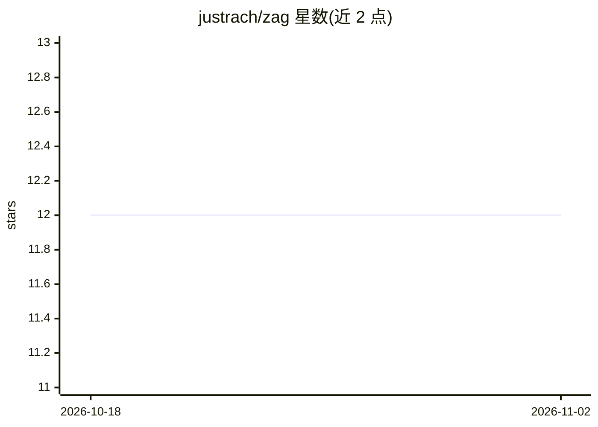

# justrach/zag

⭐ 12 · C · MIT · 推送 2026-03-24 · [GitHub](https://github.com/justrach/zag) · [官网](https://justrach.github.io/zag/) · 个人维护

**Zig 0.15.2 的实验性分支语言：无函数着色的结构化并发**

Zag 是基于 Zig 0.15.2 编译器源码的分叉语言项目，探索调用点式的零感染结构化并发：并发由调用点的 spawn/scope/channel 引入，取消是运行时状态而非参数传递，目标模型为纤程加工作窃取调度器。当前仓库处于过渡状态：已重新基于 0.15.2 编译器源码刷新，`.zag` 源文件与 CLI/格式化器支持已落地，ZEP-0002 运行时尚未完整实现，无发布包，需从源码构建。面向参与语言/编译器实验的系统编程开发者。

## 筛选速览

| 维度 | 判定 | 备注 |
|---|---|---|
| AI 角色 | `ai-enhanced` | 去掉 AI 部分产品仍成立 |
| 许可风险 | `permissive` | MIT |
| 部署形态 | `None` |  |
| 模型依赖 | — | README 未给出锁定关系 |
| 硬件要求 | — | 无带数字的原话,不猜 |
| 安装摩擦 | `low` | 无编译、无系统依赖或容器化 |
| 成熟度 | `idea` | |

## 能力要点

- `.zag` 与 `.zig` 源文件共存，同一编译管线处理
- 目标并发模型：纤程 + 工作窃取调度 + 结构化作用域 + 无参数线程化的取消
- macOS Homebrew LLVM 路径支持显式 Polly 构建选项
- 仓库主体为上游 Zig 0.15.2 源码加 Zag 定向改动，保持可 rebase

## 适用场景

- 跟进结构化并发语言设计的实验方向（ZEP-0002）
- 在 `.zag`/`.zig` 过渡兼容下试用分叉工具链
- 研究无函数着色 async 的编译器实现路径

## 场景标签

 · 领域:系统编程/编译器

## 证据(README 行号)

> L31:  of function coloring, drawing on systems like Codex, Symphony, and opencode.
> L44: Zag is currently a forked compiler/toolchain based on Zig 0.15.2.

## 星数曲线

2026-10-18 12 → 2026-11-02 12（+0）

---
*卡片 v1 · prompt 1.4 · 生成 2026-11-01 · 置信度 mid · 依据 README sha `e1450b6e2d83` · [字段定义](../../DATASET.md)*
