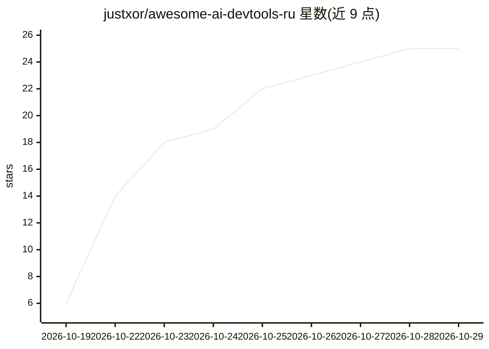

# justxor/awesome-ai-devtools-ru

⭐ 25 · NOASSERTION · 推送 2026-10-19 · [GitHub](https://github.com/justxor/awesome-ai-devtools-ru) · 组织维护

**俄语 AI 开发者工具目录：IDE、代理、MCP、LLMOps 分类清单**

面向俄语开发者的 AI 开发工具 awesome 清单：README 展示各类别精选工具（AI-IDE、IDE 扩展、终端代理），并链接到含 281 个工具、20 个类别的完整目录与四篇教程（选型、本地模型、MCP 与 AGENTS.md、代理理论）。条目按标签标注开源、免费、本地模型（Ollama/LM Studio/llama.cpp）、BYOK、MCP 支持、俄罗斯服务；另提供选型流程图、2026 年生态变化表与七种场景的现成工具栈。每月更新，CC0 许可。

## 筛选速览

| 维度 | 判定 | 备注 |
|---|---|---|
| AI 角色 | `ai-knowledge` | 知识聚合/清单类 |
| 许可风险 | `none` | NOASSERTION |
| 部署形态 | `None` |  |
| 模型依赖 | — | README 未给出锁定关系 |
| 硬件要求 | — | 无带数字的原话,不猜 |
| 安装摩擦 | `low` | 无编译、无系统依赖或容器化 |
| 成熟度 | — | 结构信号不足 |

## 能力要点

- 281 个工具、20 个类别的完整目录（俄语描述）
- 标签体系：开源/免费/本地模型/BYOK/MCP/俄罗斯服务
- 四篇教程：选型、本地模型、MCP 与 AGENTS.md、代理理论
- 按场景的现成工具栈（免费/私有/团队/无境外服务等 7 种）

## 适用场景

- 作为俄语开发者挑选 AI 编码工具的入门目录
- 对比 AI-IDE、IDE 扩展与终端代理等类别下的工具
- 查找无需境外服务的俄罗斯本地化替代方案

## 场景标签

`精选清单` · 领域:学习与行业

## 证据(README 行号)

> L5: **Самый полный каталог ИИ-инструментов для разработчиков на русском языке:** AI-IDE, расширения, терминальные агенты
> L7: Здесь собраны **сотни инструментов**, которые помогают писать, проверять и поддерживать код с помощью нейросетей: от
> L47: |📚 Полный каталог (281 инструмент)|Все инструменты из awesome-ai-devtools с описаниями на русском: 20 категорий, вк

## 星数曲线

2026-10-19 6 → 2026-10-29 25（+19）

---
*卡片 v1 · prompt 1.4 · 生成 2026-10-27 · 置信度 high · 依据 README sha `b300f80f2b8e` · [字段定义](../../DATASET.md)*
