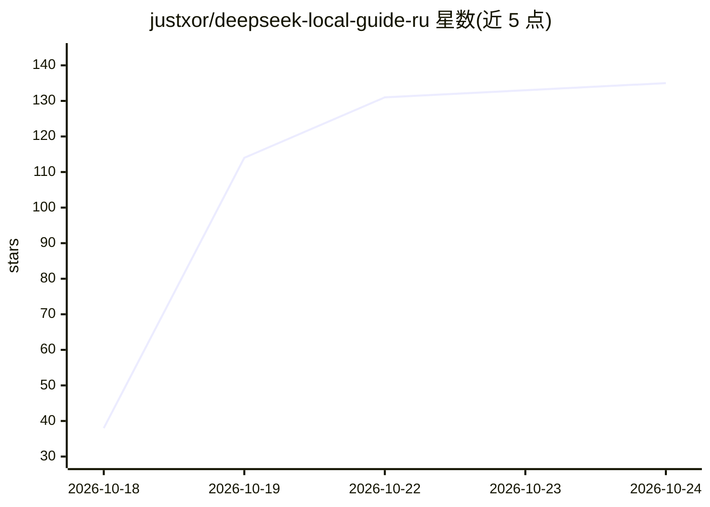

# justxor/deepseek-local-guide-ru

⭐ 135 · Shell · NOASSERTION · 推送 2026-10-17 · [GitHub](https://github.com/justxor/deepseek-local-guide-ru) · 个人维护

**俄文本地部署 DeepSeek 的完整教程与选型指南**

面向俄语读者的 DeepSeek 本地运行指南（CC BY 4.0）：覆盖模型选择（R1 蒸馏版 1.5B–70B 到 V4-Flash/V4-Pro）、显存与内存需求估算、Ollama/llama.cpp/LM Studio/Open WebUI/vLLM/SGLang 的安装配置、API 接入、RAG、agent 与微调，共 19 个部分并附独立课程文档。核心机制是按硬件（VRAM/RAM 矩阵）和任务类型给出模型与运行时的匹配建议，附带中文 DeepSeek 模型时间线（V2 至 V4.1-Flash-1017）。本体为知识文档，不含可运行代码，安装命令均指向第三方工具。

## 筛选速览

| 维度 | 判定 | 备注 |
|---|---|---|
| AI 角色 | `ai-knowledge` | 知识聚合/清单类 |
| 许可风险 | `none` | NOASSERTION |
| 部署形态 | `desktop` | 安装包/桌面程序 |
| 模型依赖 | — | README 未给出锁定关系 |
| 硬件要求 | — | 无带数字的原话,不猜 |
| 安装摩擦 | `low` | 无编译、无系统依赖或容器化 |
| 成熟度 | — | 结构信号不足 |

## 能力要点

- 按 VRAM×模型的适配矩阵与任务导向选型表
- 覆盖 Ollama/llama.cpp/LM Studio/vLLM/SGLang 多条运行路径
- DeepSeek 模型谱系（V2 至 V4.1-Flash-1017）与内存需求对照
- 包含 RAG、agent、fine-tuning、提示技巧等 19 个部分

## 适用场景

- 我在俄语环境下想一步步把 DeepSeek 跑在自己电脑上
- 我需要按自己的显卡/内存挑选合适的 DeepSeek 模型版本
- 我想了解从桌面单机到服务器（vLLM/SGLang）的部署差异

## 场景标签

`教程课程` · 领域:学习与行业

## 证据(README 行号)

> L1: DeepSeek локально — полный курс на русском 2026: Ollama, llama.cpp, LM Studio, vLLM, Open WebUI, RAG
> L3: # 🐋 DeepSeek локально — полный гайд и курс на русском (2026)
> L24: А здесь выложены **гайды** по работе с откырытми моделями и уроки по работе с ними.

## 星数曲线

2026-10-18 38 → 2026-10-24 135（+97）

---
*卡片 v1 · prompt 1.4 · 生成 2026-10-22 · 置信度 mid · 依据 README sha `e13b3ea77ff7` · [字段定义](../../DATASET.md)*
