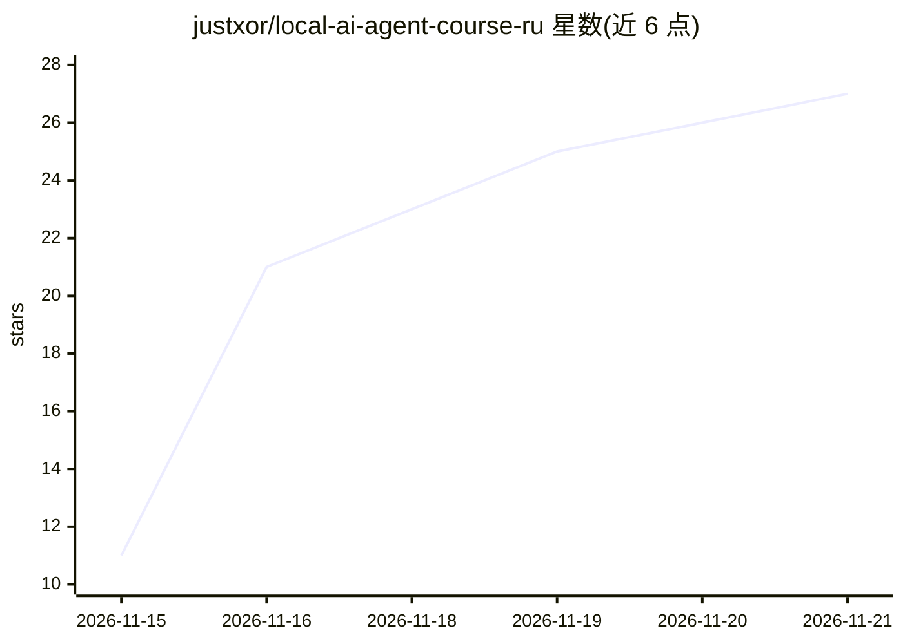

# justxor/local-ai-agent-course-ru

⭐ 27 · Python · 推送 2026-11-16 · [GitHub](https://github.com/justxor/local-ai-agent-course-ru) · 个人维护

**俄语免费课程：用 Python 与 Ollama 从零构建本地 AI agent**

面向俄语读者的实践课程：安装 Ollama 与 Python 3.10+，下载本地 LLM（Qwen/Gemma/gpt-oss 系列），通过 HTTP API 与 tool calling 构建能在 Markdown 笔记中检索事实并引用来源的 agent。课程含 11 课，覆盖模型选择（按内存与 CPU/GPU 配置给对照表）、agent 循环、模型对比评测、长期记忆与 Ollama 性能剖析。示例仅需 Python 标准库、无需 API key，另对比 LM Studio 与 llama.cpp 作为替代运行时。

## 筛选速览

| 维度 | 判定 | 备注 |
|---|---|---|
| AI 角色 | `ai-knowledge` | 知识聚合/清单类 |
| 许可风险 | `none` | — |
| 部署形态 | `desktop` | 安装包/桌面程序 |
| 模型依赖 | local-ok | 支持本地模型 |
| 硬件要求 | — | 无带数字的原话,不猜 |
| 安装摩擦 | `low` | 无编译、无系统依赖或容器化 |
| 成熟度 | — | 结构信号不足 |

## 能力要点

- 11 课实践课程：从模型选择到最终项目构建知识库 agent
- agent 通过 tool calling 在 Markdown 笔记中检索并引用来源文件
- 按 RAM/VRAM 配置给出 Qwen/Gemma/gpt-oss 模型选择对照表
- 示例仅依赖 Python 标准库，通过 Ollama 本地 API 运行，无需 API key

## 适用场景

- 我想学习在本地从零搭建带工具调用的 AI agent
- 我想比较 Qwen 与 Gemma 在自己电脑上的表现并选型
- 我想让 agent 基于自己的 Markdown 笔记回答并给出出处

## 场景标签

`教程课程` `RAG` · 领域:知识与检索

## 证据(README 行号)

> L1: # Локальный ИИ-агент на Python и Ollama с нуля
> L5: Бесплатный практический курс на русском. Вы скачаете локальную LLM, подключите её к Python и соберёте агента, которы
> L28: ## Программа курса

## 星数曲线

2026-11-15 11 → 2026-11-21 27（+16）

---
*卡片 v1 · prompt 1.4 · 生成 2026-11-18 · 置信度 high · 依据 README sha `c839f32ba309` · [字段定义](../../DATASET.md)*
