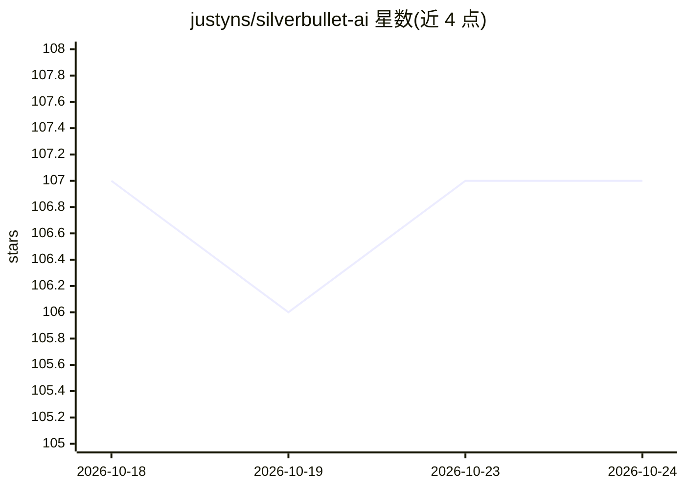

# justyns/silverbullet-ai

⭐ 107 · TypeScript · AGPL-3.0 · 推送 2026-10-22 · [GitHub](https://github.com/justyns/silverbullet-ai) · [官网](https://ai.silverbullet.md/) · 个人维护

**为 SilverBullet 笔记工具集成 LLM 的插件**

SilverBullet（markdown 笔记工具）的插件，将 LLM 功能嵌入笔记工作流：页面内多轮对话、右侧 AI 助手面板、基于向量嵌入的 RAG 检索、模板化提示词、AI Agent 人格与工具调用、DALL-E 图片生成、笔记摘要（实验性）。支持 OpenAI、Google Gemini、Ollama、Mistral、Perplexity、OpenRouter 及任意 OpenAI 兼容 API，配置通过 Space Lua 完成。README 声明仍处早期开发、测试不充分，提醒用户备份笔记。面向 SilverBullet 用户。

## 筛选速览

| 维度 | 判定 | 备注 |
|---|---|---|
| AI 角色 | `ai-enhanced` | 去掉 AI 部分产品仍成立 |
| 许可风险 | `viral` | AGPL-3.0 |
| 部署形态 | `library` | 以包/库形式分发 |
| 模型依赖 | local-ok | 支持本地模型 |
| 硬件要求 | — | 无带数字的原话,不猜 |
| 安装摩擦 | `low` | 无编译、无系统依赖或容器化 |
| 成熟度 | `idea` | |

## 能力要点

- 页面内多轮对话与持久化 AI 助手面板
- 基于向量嵌入与余弦相似度的 RAG 检索
- AI Agent 人格、内置工具与自定义工具审批门控
- 支持 OpenAI/Gemini/Ollama/OpenRouter 等多种提供商

## 适用场景

- 在笔记内直接与 LLM 对话并追加到当前页
- 对笔记空间做语义搜索和 RAG 问答
- 用模板页面定义可复用的自定义 AI 提示词
- 配置多个提供商与模型按需切换

## 场景标签

`RAG` `知识库管理` `聊天机器人` · 领域:对话与助手

## 证据(README 行号)

> L3: This plug integrates various LLMs (Large Language Models) into SilverBullet, the markdown-based note taking tool, al
> L15: - **RAG (Retrieval Augmented Generation)**: Automatic vector embedding search for relevant context

## 星数曲线

2026-10-18 107 → 2026-10-24 107（+0）

---
*卡片 v1 · prompt 1.4 · 生成 2026-10-23 · 置信度 high · 依据 README sha `d96de78f98d3` · [字段定义](../../DATASET.md)*
