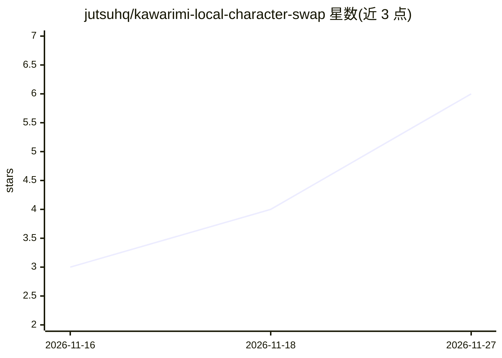

# jutsuhq/kawarimi-local-character-swap

⭐ 6 · Rust · MIT · 推送 2026-11-24 · [GitHub](https://github.com/jutsuhq/kawarimi-local-character-swap) · [官网](https://jutsustudio.com/kawarimi/) · 组织维护

**本地 GPU 视频角色替换工具：单张图换掉视频中人物**

基于 Wan 2.2 Animate 的桌面应用，在本地 NVIDIA GPU 上将 4–30 秒视频中的人物替换为一张图片中的角色，全程离线、无账号、无云端调用。流程为 Rust + ONNX Runtime 做剪辑检测、人物检测、跟踪与抠像（TransNetV2/RT-DETRv2/EdgeTAM/SAM/BiRefNet），渲染交给应用托管或自有的 ComfyUI，可选本地 LLM 写提示词。提供 Windows 安装包、deb 与 AppImage，并附 MCP server 供 Claude Code 等 MCP 客户端排队预处理与渲染。限制：不支持 Mac、AMD/Intel GPU，输出 16 fps，Windows 安装包未签名。

## 筛选速览

| 维度 | 判定 | 备注 |
|---|---|---|
| AI 角色 | `ai-native` | 本体是模型或模型工具 |
| 许可风险 | `permissive` | MIT |
| 部署形态 | `desktop` | 安装包/桌面程序 |
| 模型依赖 | local-ok | 支持本地模型 |
| 硬件要求 | — | 无带数字的原话,不猜 |
| 安装摩擦 | `high` | 编译与系统依赖俱全 |
| 成熟度 | — | 结构信号不足 |

## 能力要点

- 全流程本地离线：检测/跟踪/抠像/渲染均在自有 GPU 完成，SHA-256 校验模型下载
- 预处理 Rust + ONNX Runtime，渲染运行于应用托管或自有 ComfyUI
- 提供 kawarimi-mcp MCP server，可由 Claude Code 等 MCP 客户端驱动
- 任务队列支持中途关闭并在重启后恢复

## 适用场景

- 把短视频里的人物换成指定图片角色且不联网上传素材
- 对隐私敏感的素材做本地角色替换
- 通过 MCP 客户端脚本化批量排队视频替换任务

## 场景标签

`视频生成` · 领域:内容生成

## 证据(README 行号)

> L5: **Kawarimi is a free, open-source Viggle alternative for Windows and Linux.** It swaps a person in a 4–30 s clip for
> L110: |8|Render|Wan 2.2 Animate on ComfyUI|

## 星数曲线

2026-11-16 3 → 2026-11-27 6（+3）

---
*卡片 v1 · prompt 1.4 · 生成 2026-11-26 · 置信度 mid · 依据 README sha `b354400a2fca` · [字段定义](../../DATASET.md)*
