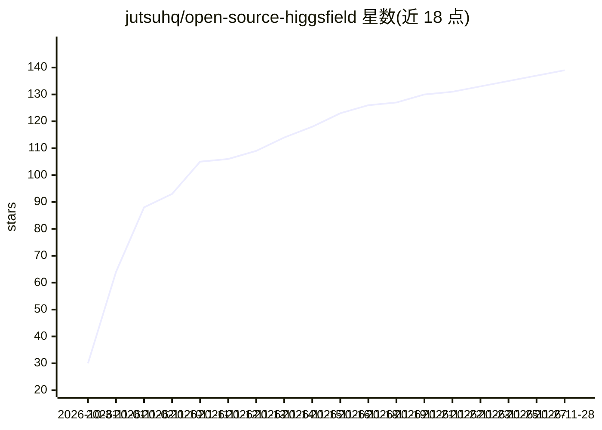

# jutsuhq/open-source-higgsfield

⭐ 139 · JavaScript · CC0-1.0 · 推送 2026-11-23 · [GitHub](https://github.com/jutsuhq/open-source-higgsfield) · [官网](https://jutsustudio.com/open-source-higgsfield/) · 组织维护

**Higgsfield 开源替代项目的策展清单：117 个 AI 视频项目**

一份非官方社区维护的 awesome 清单，收录 117 个开源 Higgsfield AI 替代项目，其中 110 个来自 ComfyUI #OpenSourceHiggsfield 挑战赛（含 16 个获奖项目），7 个更早期项目。按角色替换、特效、镜头重拍、影片与一体化工作室等类别组织，附星标数、许可证统计（截至 2026-11-19）与挑战赛时间线，提供 data/projects.json 机器可读数据和 node 脚本重建，清单本身以 CC0 1.0 发布。不提供工具安装与运行说明。

## 筛选速览

| 维度 | 判定 | 备注 |
|---|---|---|
| AI 角色 | `ai-knowledge` | 知识聚合/清单类 |
| 许可风险 | `viral` | CC0-1.0 |
| 部署形态 | `None` |  |
| 模型依赖 | — | README 未给出锁定关系 |
| 硬件要求 | — | 无带数字的原话,不猜 |
| 安装摩擦 | `medium` | 含编译或系统依赖之一 |
| 成熟度 | — | 结构信号不足 |

## 能力要点

- 收录 117 个项目：110 个来自挑战赛，16 个获奖者
- 按 9 个类别组织：角色替换、一体化工作室、特效等
- 提供机器可读数据 data/projects.json 与构建脚本
- 清单以 CC0 1.0 许可发布

## 适用场景

- 查找 Higgsfield 功能的开源替代实现
- 了解 #OpenSourceHiggsfield 挑战赛项目与获奖名单
- 按许可证和星标数筛选 AI 视频开源项目

## 场景标签

`视频生成` `精选清单` · 领域:内容生成

## 证据(README 行号)

> L3: There are 117 open-source Higgsfield AI alternatives in this list: 110 GitHub projects from ComfyUI's #OpenSourceHig
> L34: |Machine-readable data|data/projects.json|
> L36: |List license|CC0 1.0|

## 星数曲线

2026-10-31 30 → 2026-11-28 139（+109）

---
*卡片 v1 · prompt 1.4 · 生成 2026-11-28 · 置信度 high · 依据 README sha `8bc80fc675ba` · [字段定义](../../DATASET.md)*
