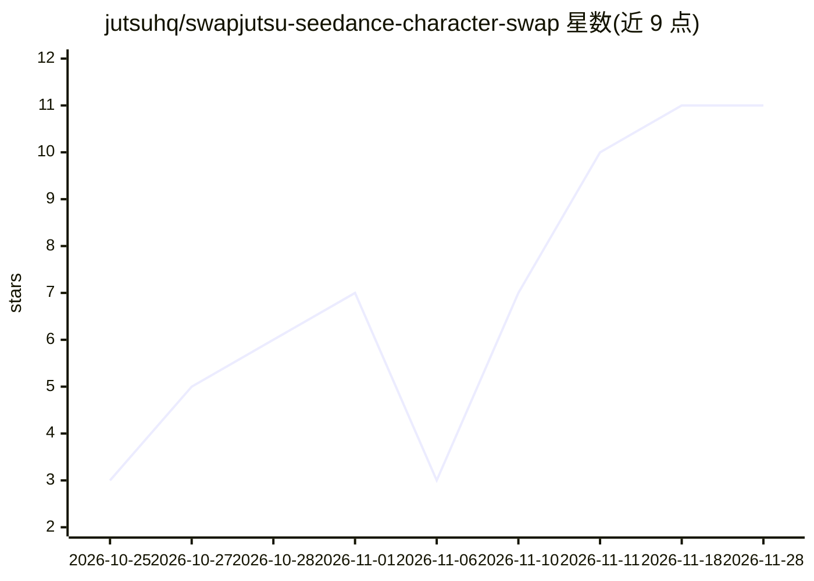

# jutsuhq/swapjutsu-seedance-character-swap

⭐ 11 · Swift · MIT · 推送 2026-11-23 · [GitHub](https://github.com/jutsuhq/swapjutsu-seedance-character-swap) · [官网](https://jutsustudio.com/swapjutsu/) · 组织维护

**Mac 上的视频角色替换应用：本地预处理，云端或自有 GPU 渲染**

运行于 macOS 15+ Apple Silicon 的原生 Swift 应用，用于将视频中的人物替换为图片中的角色。流程分两段：镜头切分、人物掩码、EdgeTAM 跟踪、深度估计（Depth Anything V2）与本地 Qwen3-VL 提示词生成在 Mac 上离线完成；渲染经 Comfy 的 API 调用 Seedance 2.5（按 credits 计费）或用户自有 ComfyUI 上的 Wan 2.2 Animate（免费）。内置带每日预算限制的 MCP 服务器，可由 MCP 客户端代为执行准备与渲染。输入限制为 4–30 秒片段。

## 筛选速览

| 维度 | 判定 | 备注 |
|---|---|---|
| AI 角色 | `ai-native` | 本体是模型或模型工具 |
| 许可风险 | `permissive` | MIT |
| 部署形态 | `desktop` | 安装包/桌面程序 |
| 模型依赖 | — | README 未给出锁定关系 |
| 硬件要求 | — | 无带数字的原话,不猜 |
| 安装摩擦 | `medium` | 含编译或系统依赖之一 |
| 成熟度 | — | 结构信号不足 |

## 能力要点

- 预处理全程在 Mac 离线运行（Vision/Core ML/MLX），渲染阶段才出云
- 双渲染路径：Comfy 云端 Seedance 2.5 或自有 ComfyUI 上免费的 Wan 2.2 Animate
- 内置 MCP 服务器，支持 MCP 客户端自动执行准备与渲染，带每日预算与权限限制
- 可选本地提示词模型（Qwen3-VL 8B 等 5 个 MLX 4-bit 转换版本，16 GB 内存）

## 适用场景

- 将视频中的舞者/人物替换为指定图片角色并保持动作一致
- 在自有 ComfyUI + GPU 上零成本完成角色替换渲染
- 通过 Claude Code 等 MCP 客户端以代理方式批量准备和渲染视频

## 场景标签

`视频生成` · 领域:内容生成

## 证据(README 行号)

> L5: **Swapjutsu is a free, open-source app to swap a character in a video on Mac, with no watermark.** It runs on
> L29: |Models|Render: Seedance 2.5, Wan 3.0 (clips up to 15 s), or Wan 2.2 Animate on your ComfyUI. On the Mac: EdgeTAM i
> L93: |1|Shots|Mac|Cuts found from feature-print and colour-histogram jumps|02|
> L129: The app ships an MCP server, so Claude Code or any MCP client can prepare and render for you:

## 星数曲线

2026-10-25 3 → 2026-11-28 11（+8）

---
*卡片 v1 · prompt 1.4 · 生成 2026-11-18 · 置信度 high · 依据 README sha `2717c5d0ceb8` · [字段定义](../../DATASET.md)*
