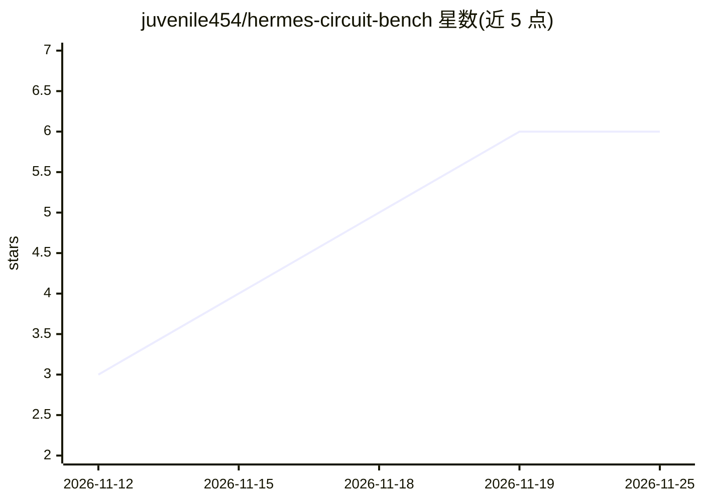

# juvenile454/hermes-circuit-bench

⭐ 6 · Python · MIT · 推送 2026-11-23 · [GitHub](https://github.com/juvenile454/hermes-circuit-bench) · 个人维护

**Hermes 用户的 ESP32 电子工作台插件：从选脚到烧录全程计算可溯源**

作为 Hermes 的插件运行的 ESP32 开发工作台，分六个工位：GPIO 选脚核对 Espressif 数据、16 种电路计算器、原理图生成、焊接顺序、经确认的构建/烧录（PlatformIO + esptool）、串口监视与 panic 反解。所有判定和元件值在代码中计算并标注出处，数据表逐行引用；无硬件时提供模拟板（结果标 SIMULATED）。脱离 Hermes Desktop 时同样 7 个工具可在 CLI 与消息平台使用。烧录与构建有多层确认与哈希校验机制。

## 筛选速览

| 维度 | 判定 | 备注 |
|---|---|---|
| AI 角色 | `ai-enhanced` | 去掉 AI 部分产品仍成立 |
| 许可风险 | `permissive` | MIT |
| 部署形态 | `None` |  |
| 模型依赖 | — | README 未给出锁定关系 |
| 硬件要求 | — | 无带数字的原话,不猜 |
| 安装摩擦 | `low` | 无编译、无系统依赖或容器化 |
| 成熟度 | — | 结构信号不足 |

## 能力要点

- 六工位流程：选脚、计算、接线、焊接、烧录、调试，判定均给出规则与来源
- 180 个常用模块、30 个家族，元件值附数据表页码与原文行
- 构建/烧录需逐步确认并校验芯片、MAC 与固件哈希
- 模拟板 demo 无需硬件与 PlatformIO 即可体验

## 适用场景

- 无硬件时先用模拟项目熟悉 ESP32 开发流程
- 为 ESP32 项目核对 GPIO 分配与元件参数取值
- 按焊接顺序与极性提示组装模块
- 在 Hermes 中对话式修复固件崩溃并重新烧录

## 场景标签

`编码 Agent` · 领域:编码与开发

## 证据(README 行号)

> L7: An ESP32 workbench for Hermes: from pin choice to running firmware, with every pin verdict and every part value
> L66: **▤ Projects** opens, creates or deletes projects (deleted ones go to the bench trash). Without Hermes Desktop
> L67: the same seven tools work in the CLI and on messaging platforms; `/bench doctor`, `/bench ports` and

## 星数曲线

2026-11-12 3 → 2026-11-25 6（+3）

---
*卡片 v1 · prompt 1.4 · 生成 2026-11-20 · 置信度 high · 依据 README sha `3b948f739653` · [字段定义](../../DATASET.md)*
