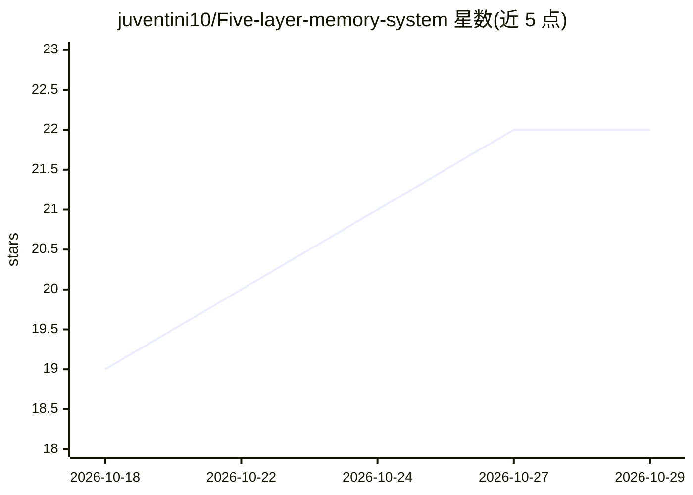

# juventini10/Five-layer-memory-system

⭐ 22 · Python · MIT · 推送 2026-10-27 · [GitHub](https://github.com/juventini10/Five-layer-memory-system) · [官网](https://github.com/juventini10/Five-layer-memory-system) · 个人维护 · 中文 README

**跨 8 端 AI 工具的五层记忆系统安装包，让 AI 持续记住用户**

面向个人用户的 AI 记忆系统安装包：用户答 33 道题，AI 工具据此建立 L1 核心价值观到 L5 潜意识层的五层记忆结构，并配 10 个联动 Skill（系统日志、每日伙伴、深度对话等）与月度/周度校准。适配 WorkBuddy、Qoder CN、Trae Work、ZCode、豆包、Hermes、Zwork 等 8 端，安装按端能力分流；Zwork 端走对账吸收模式，LobsterAI 适配未完。zip 渠道需先做 sha256 校验，安装由 AI 读取 INSTALL.md 自动执行，含全彩 HTML 洞察报告。MIT 协议，要求保留设计者署名。

## 筛选速览

| 维度 | 判定 | 备注 |
|---|---|---|
| AI 角色 | `ai-ecosystem` | LLM/agent 周边工具 |
| 许可风险 | `permissive` | MIT |
| 部署形态 | `None` |  |
| 模型依赖 | — | README 未给出锁定关系 |
| 硬件要求 | — | 无带数字的原话,不猜 |
| 安装摩擦 | `low` | 无编译、无系统依赖或容器化 |
| 成熟度 | `idea` | |

## 能力要点

- 33 题建立五层记忆结构（核心/认知/行为/情境/潜意识），各有更新频率
- 10 个 Skill 联动工作，数据在 Skill 间流动
- 8 端适配：WorkBuddy/Qoder CN/Trae Work/ZCode/豆包/Hermes/LobsterAI/Zwork
- 发布前强制完整性校验（sha256/verify.sh），AI 读 INSTALL.md 自动安装

## 适用场景

- 让常用的 AI 助手跨对话记住自己的偏好与决定
- 通过答题生成个人洞察报告与 AI 协作契约
- 用晨规划、记账、晚复盘等 Skill 管理日常工作节奏

## 场景标签

`AI 助手` `Agent 记忆` · 领域:Agent 开发

## 证据(README 行号)

> L36: 不是"喂一堆资料"，是让你答33道精心设计的题——关于你的取舍、你的盲点、你的行为模式。你手上的 AI（按 Step -0.5 判定的端能力装载）根据你的真实回答，自动建立起五层记忆结构：
> L4: > v2.1：适配 **8 端**（包内 8 端适配层，用户面 7 端可装（Trae Work 新版适配未完·暂不亮牌；LobsterAI 适配收尾中·暂不推荐）——WorkBuddy / Qoder CN（含 Qoder CN I

## 星数曲线

2026-10-18 19 → 2026-10-29 22（+3）

---
*卡片 v1 · prompt 1.4 · 生成 2026-10-28 · 置信度 high · 依据 README sha `f939d94b377e` · [字段定义](../../DATASET.md)*
