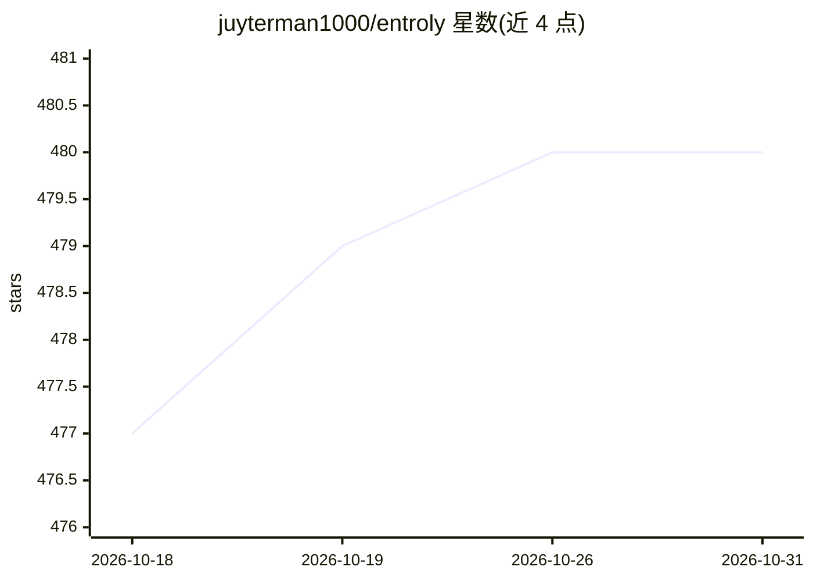

# juyterman1000/entroly

⭐ 480 · Python · Apache-2.0 · 推送 2026-10-30 · [GitHub](https://github.com/juyterman1000/entroly) · [官网](https://juyterman1000.github.io/entroly/docs/index.html) · 个人维护 · 中文 README

**AI 编码工具的上下文选择与压缩层，附带可审计回执**

面向 AI 编码工具的本地优先上下文控制层：在 token 预算内选择证据、保留可恢复的省略内容，并以内容寻址方式字节级恢复原文。每次压缩生成回执，记录保留与省略的内容。接入方式包括本地代理、MCP、SDK、插件/hook，支持 Claude Code、Codex、Cursor、VS Code、GitHub Copilot 等宿主。提供 Python（完整功能）、npm、Rust 源码构建、Homebrew、Docker 五种安装途径。本地验证命令无需 API key；原生引擎默认不自动下载。

## 筛选速览

| 维度 | 判定 | 备注 |
|---|---|---|
| AI 角色 | `ai-ecosystem` | LLM/agent 周边工具 |
| 许可风险 | `permissive` | Apache-2.0 |
| 部署形态 | `self-host` | docker 或自建部署 |
| 模型依赖 | — | README 未给出锁定关系 |
| 硬件要求 | — | 无带数字的原话,不猜 |
| 安装摩擦 | `low` | 无编译、无系统依赖或容器化 |
| 成熟度 | — | 结构信号不足 |

## 能力要点

- 预算内证据选择与可恢复压缩，字节级恢复原文（66/66 重启恢复测试）
- 每次压缩生成回执，记录保留/省略内容及恢复句柄
- 接入方式覆盖代理、MCP、Python SDK、各 IDE 插件/hook
- 本地验证命令（verify-claims/simulate）无需 API key

## 适用场景

- 长 agent 会话接近上下文限时自动压缩工具输出，避免手动 /compact
- 在自己的应用中按预算压缩 prompt 与消息
- 跨编码 agent 中途切换时从仓库证据恢复未完成工作
- 在连接付费 API 前用本地命令验证压缩效果

## 场景标签

`提示工程` · 领域:Agent 开发

## 证据(README 行号)

> L12:  Entroly is an open-source, local-first AI token-efficiency and Context Assurance layer: budgeted evidence selectio
> L33: Entroly is a local-first context control plane for AI coding tools. It selects
> L175: Use Entroly at the SDK, framework, proxy, MCP, plugin or agent boundary. A

## 星数曲线

2026-10-18 477 → 2026-10-31 480（+3）

---
*卡片 v1 · prompt 1.4 · 生成 2026-10-23 · 置信度 high · 依据 README sha `bad50c7b0b7d` · [字段定义](../../DATASET.md)*
